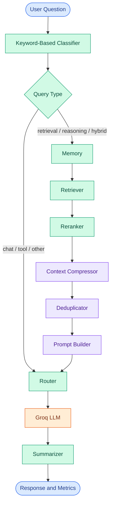

# Token Cost Agent

<p align="center">
  <strong>Context Engineering for Efficient LLM Applications</strong>
  <br>
  A modular Python workflow for query routing, context refinement, and token-usage analysis.
</p>

<p align="center">
  <a href="https://github.com/maahii-in/token-cost-cutting">
    
  </a>
  <a href="https://github.com/maahii-in/token-cost-cutting">
    
  </a>
  <a href="https://groq.com/">
    
  </a>
  <a href="https://github.com/maahii-in/token-cost-cutting/stargazers">
    
  </a>
  <a href="https://github.com/maahii-in/token-cost-cutting/commits/main">
    
  </a>
</p>

<p align="center">
  <a href="#overview">Overview</a> ·
  <a href="#system-architecture">Architecture</a> ·
  <a href="#getting-started">Installation</a> ·
  <a href="#configuration">Configuration</a> ·
  <a href="#evaluation-methodology">Evaluation</a> ·
  <a href="#contributing">Contributing</a>
</p>

---

## Table of Contents

- [Overview](#overview)
- [Problem Statement](#problem-statement)
- [Design Principles](#design-principles)
- [Capabilities](#capabilities)
- [Technology Stack](#technology-stack)
- [System Architecture](#system-architecture)
- [Workflow Routing](#workflow-routing)
- [State and Data Contracts](#state-and-data-contracts)
- [Repository Structure](#repository-structure)
- [Getting Started](#getting-started)
- [Configuration](#configuration)
- [Running the Agent](#running-the-agent)
- [Observability and Token Accounting](#observability-and-token-accounting)
- [Testing](#testing)
- [Evaluation Methodology](#evaluation-methodology)
- [Limitations and Engineering Considerations](#limitations-and-engineering-considerations)
- [Troubleshooting](#troubleshooting)
- [Roadmap](#roadmap)
- [Contributing](#contributing)
- [Security](#security)
- [Maintainer](#maintainer)

## Overview

**Token Cost Agent** is a Python-based project that explores token-aware processing and context engineering for large language model (LLM) applications.

The application uses [LangGraph](https://langchain-ai.github.io/langgraph/) to coordinate specialized components for query classification, memory processing, document retrieval, reranking, context compression, deduplication, prompt construction, response generation, and summarization.

A shared Pydantic state carries information between nodes. The application also maintains token-related metrics that can be inspected after workflow execution.

### Primary objective

Investigate how context selection and prompt-processing strategies affect:

- Input-token consumption.
- Response relevance and quality.
- End-to-end execution time.
- Estimated LLM request cost.
- Workflow maintainability and observability.

The project provides a foundation for experimentation; it does not assume that adding an optimization stage automatically makes a workflow cheaper or better.

**Project status:** Under development. Benchmark results, production readiness, and cost savings should be established through actual testing.

## Problem Statement

LLM applications may consume unnecessary input tokens when prompts contain irrelevant information, repeated content, or oversized context.

Reducing context indiscriminately can also remove useful information and degrade response quality. An effective optimization strategy must therefore balance input size against answer usefulness.

Token Cost Agent explores several independently identifiable processing stages.

| Challenge | Current approach |
|---|---|
| Different question types need different execution paths | Keyword-based query classification |
| Retrieved content may be poorly prioritized | Retrieval and reranking stages |
| Context may contain excessive information | Context-compression stage |
| Documents may contain repeated information | Deduplication stage |
| Workflow logic can become difficult to maintain | Modular LangGraph nodes |
| Components need a shared data representation | Pydantic `AgentState` |
| Token usage needs visibility | Per-node token metrics |
| Optimization needs evidence | Baseline-versus-optimized evaluation |

The intended outcome is **measurable context efficiency without unacceptable loss of response quality**.

## Design Principles

### Separation of concerns

Classification, retrieval, reranking, compression, prompt construction, generation, and summarization are implemented as distinct workflow nodes.

This structure supports targeted changes and makes it easier to identify where unexpected behavior occurs.

### Explicit workflow state

Nodes exchange information through the shared `AgentState` model instead of relying entirely on unrelated local variables.

### Centralized configuration

Model identifiers, database connection settings, retrieval limits, token limits, and logging options are managed through `config.py` and Pydantic Settings.

### Observable execution

The application logs relevant events and prints the token-related metrics recorded in its workflow state.

### Evidence-based optimization

Context-processing stages should be evaluated against a baseline using equivalent inputs and consistent response-quality criteria.

## Capabilities

### Query classification and routing

A rule-based classifier categorizes incoming questions into supported query types:

- `chat`
- `retrieval`
- `reasoning`
- `tool`
- `hybrid`

The classification result controls the conditional routing defined in `graph.py`.

### Retrieval and context refinement

The retrieval-oriented workflow contains dedicated stages for memory, document retrieval, reranking, compression, deduplication, and prompt construction.

### Language-model integration

The LLM node uses the Groq SDK to send a constructed prompt to the configured model.

The current LLM request uses a temperature of `0.2` and a maximum output length of `1024` tokens.

### Structured workflow state

The state model carries the question, query type, retrieved documents, compressed documents, constructed prompt, generated response, token usage, and metadata.

### Token usage reporting

The application reports the token-related metrics recorded by nodes that populate the shared state.

These metrics are useful for inspecting the workflow, but they should not automatically be treated as exact provider billing data.

### External service configuration

The project includes configuration for PostgreSQL, Milvus, Redis, embedding models, and reranking models. The services required at runtime depend on the selected execution path and node implementation.

## Technology Stack

| Technology | Responsibility |
|---|---|
| Python | Core application |
| LangGraph | Stateful workflow orchestration |
| LangChain | LLM application components |
| Groq SDK | Language-model API integration |
| PostgreSQL | Relational database integration |
| Milvus | Vector database integration |
| Redis | Cache integration |
| Sentence Transformers | Embedding and reranking model support |
| `tiktoken` | Local token counting |
| Pydantic | Data validation |
| Pydantic Settings | Environment-based configuration |
| pytest | Automated testing |

### Configured models

| Component | Configuration default |
|---|---|
| Language model | `llama-3.3-70b-versatile` |
| Embedding model | `BAAI/bge-small-en-v1.5` |
| Reranking model | `BAAI/bge-reranker-base` |

These are the models specified in the current configuration, not a claim that every component has been benchmarked or is necessary for every request.

## System Architecture

The workflow is defined in [`graph.py`](graph.py) using LangGraph's `StateGraph`.



### Component responsibilities

| Component | Responsibility |
|---|---|
| Classifier | Categorizes the incoming question |
| Memory | Handles the workflow's memory stage |
| Retriever | Retrieves candidate documents |
| Reranker | Reorders retrieved documents |
| Compressor | Processes the retrieved context |
| Deduplicator | Handles repeated context |
| Prompt Builder | Constructs the prompt |
| Router | Passes the request to the generation stage |
| LLM | Generates the response |
| Summarizer | Processes the generated response |

The diagram reflects the graph edges in the repository. Node internals and external service behavior are defined separately in the `nodes/` and `db/` directories.

## Workflow Routing

The routing function `route_after_classifier()` selects a branch using `state.query_type`.

| Query type | Execution route |
|---|---|
| `chat` | Router → LLM → Summarizer |
| `tool` | Router → LLM → Summarizer |
| `retrieval` | Memory → Retriever → Reranker → Compressor → Deduplicator → Prompt Builder → Router → LLM → Summarizer |
| `reasoning` | Memory → Retriever → Reranker → Compressor → Deduplicator → Prompt Builder → Router → LLM → Summarizer |
| `hybrid` | Memory → Retriever → Reranker → Compressor → Deduplicator → Prompt Builder → Router → LLM → Summarizer |
| Other values | Router → LLM → Summarizer |

The classifier is keyword-based, not a trained intent model. Its categorization may fail for ambiguous questions, synonyms, or requests whose intent is not represented in its rules.

The graph routes according to the resulting classification; it does not independently guarantee that the classification is correct.

## State and Data Contracts

The project defines its document and workflow state models in [`state.py`](state.py).

### Document model

The `Document` model represents a piece of retrieved information.

| Field | Type | Purpose |
|---|---|---|
| `id` | `str` | Document identifier |
| `content` | `str` | Document text |
| `score` | `float` | Relevance score |
| `source` | `str` | Document source |
| `metadata` | `dict[str, Any]` | Additional attributes |
| `embedding` | `list[float] \| None` | Optional embedding vector |

### Agent state

The `AgentState` model carries information through the graph.

| Field | Purpose |
|---|---|
| `question` | Original user question |
| `query_type` | Classifier result |
| `memories` | Memory strings |
| `retrieved_docs` | Retrieved document collection |
| `reranked_docs` | Reranked document collection |
| `compressed_docs` | Processed document collection |
| `prompt` | Constructed LLM prompt |
| `response` | Generated response |
| `token_usage` | Metrics recorded by workflow nodes |
| `metadata` | Additional state information |

Default factories are used for collection and dictionary fields, avoiding shared mutable defaults across instances.

For implementation details, see [`state.py`](state.py).

## Repository Structure

```text
token-cost-cutting/
│
├── common/                 # Shared utilities and token-counting helpers
├── db/                     # Database integrations
├── nodes/                  # Workflow processing nodes
├── prompts/                # Prompt templates
├── tests/                  # Test-related modules
│
├── app.py                  # Interactive CLI entry point
├── config.py               # Centralized configuration
├── graph.py                # LangGraph definition
├── state.py                # Document and agent state models
│
├── test_db.py              # Database test module
├── test_milvus.py          # Milvus test module
├── requirements.txt        # Python dependencies
└── .gitignore              # Git exclusions
```

## Getting Started

### Prerequisites

- Python and pip.
- Git.
- A valid Groq API key.
- PostgreSQL credentials.
- Any additional services required by the nodes you intend to execute.

PostgreSQL, Milvus, and Redis may require separate provisioning and initialization. Check the database and node implementations for their actual runtime requirements.

### 1. Clone the repository

```bash
git clone https://github.com/maahii-in/token-cost-cutting.git
cd token-cost-cutting
```

### 2. Create a virtual environment

**Windows PowerShell**

```powershell
python -m venv .venv
.\.venv\Scripts\Activate.ps1
```

**macOS / Linux**

```bash
python3 -m venv .venv
source .venv/bin/activate
```

### 3. Install dependencies

```bash
python -m pip install --upgrade pip
pip install -r requirements.txt
```

Check dependency consistency:

```bash
pip check
```

Some machine-learning dependencies may download model files when first used and may require additional memory, storage, or system libraries.

### 4. Configure the environment

Create a `.env` file in the repository root.

```dotenv
# Application
APP_NAME=Token Cost Agent
APP_ENV=development
APP_DEBUG=true

# Groq
GROQ_API_KEY=your_groq_api_key
GROQ_MODEL=llama-3.3-70b-versatile

# PostgreSQL
POSTGRES_HOST=localhost
POSTGRES_PORT=5432
POSTGRES_DB=token_cost_agent
POSTGRES_USER=postgres
POSTGRES_PASSWORD=your_database_password

# Milvus
MILVUS_HOST=localhost
MILVUS_PORT=19530
MILVUS_COLLECTION=documents

# Redis
REDIS_HOST=localhost
REDIS_PORT=6379
REDIS_DB=0
```

The values above follow the current settings defaults. Review `config.py` for the authoritative configuration and any additional options needed in your environment.

**Important:** The current settings model requires `GROQ_API_KEY` and `POSTGRES_PASSWORD` at initialization. Provide valid values even if the initial query path does not use every configured service.

Never commit real credentials, `.env` files, or secret values to GitHub.

## Configuration

Settings are centralized in [`config.py`](config.py) and loaded using Pydantic Settings.

| Setting | Default | Purpose |
|---|---|---|
| `APP_NAME` | `Token Cost Agent` | Application name |
| `APP_ENV` | `development` | Runtime environment |
| `APP_DEBUG` | `True` | Debug setting |
| `GROQ_API_KEY` | Required | Groq API credential |
| `GROQ_MODEL` | `llama-3.3-70b-versatile` | LLM identifier |
| `POSTGRES_HOST` | `localhost` | PostgreSQL host |
| `POSTGRES_PORT` | `5432` | PostgreSQL port |
| `POSTGRES_DB` | `token_cost_agent` | Database name |
| `POSTGRES_USER` | `postgres` | Database user |
| `POSTGRES_PASSWORD` | Required | Database password |
| `MILVUS_HOST` | `localhost` | Milvus host |
| `MILVUS_PORT` | `19530` | Milvus port |
| `MILVUS_COLLECTION` | `documents` | Collection name |
| `REDIS_HOST` | `localhost` | Redis host |
| `REDIS_PORT` | `6379` | Redis port |
| `REDIS_DB` | `0` | Redis database index |
| `EMBEDDING_MODEL` | `BAAI/bge-small-en-v1.5` | Embedding model |
| `RERANKER_MODEL` | `BAAI/bge-reranker-base` | Reranker model |
| `TOP_K` | `10` | Retrieval result limit |
| `RERANK_TOP_K` | `5` | Reranked result limit |
| `SIMILARITY_THRESHOLD` | `0.75` | Similarity threshold |
| `MAX_DOCUMENT_TOKENS` | `300` | Document token limit |
| `MAX_PROMPT_TOKENS` | `4000` | Prompt token limit |
| `LOG_LEVEL` | `INFO` | Logging level |
| `LOG_FILE` | `logs/agent.log` | Log destination |
| `ENABLE_TOKEN_LOGGING` | `True` | Token logging flag |
| `ENABLE_COST_TRACKING` | `True` | Cost tracking flag |
| `CHECKPOINT_PATH` | `checkpoints/` | Checkpoint directory |
| `CACHE_TTL` | `3600` | Cache time-to-live |
| `HOST` | `0.0.0.0` | Configured host |
| `PORT` | `8000` | Configured port |

These settings describe configurable behavior; they do not establish that every service or option is used by every request.

**Execution note:** The current application entry point is an interactive CLI. `HOST` and `PORT` are configuration values and do not by themselves start an HTTP server.

## Running the Agent

Start the application from the repository root:

```bash
python app.py
```

The application displays a banner and prompts for a question.

```text
Question > How can I reduce unnecessary context in an LLM prompt?
```

The graph processes the question and displays the generated answer followed by the usage metrics stored in the returned state.

To exit the application, enter:

```text
exit
```

The commands `quit` and `q` are also supported. You can press `Ctrl+C` to interrupt execution.

### Example output

```text
============================================================
TOKEN COST AGENT
============================================================

Question > [Your question]

============================================================
ANSWER
============================================================

[Generated response]

============================================================
TOKEN USAGE
============================================================

[Recorded metrics by workflow node]
```

This is an illustrative format, not an actual execution log. Output depends on successful initialization and the runtime configuration.

## Observability and Token Accounting

The project uses shared state to expose metrics recorded by workflow nodes.

### Current token-counting behavior

The token-counting utility in `common/token_counter.py` uses:

```python
tiktoken.get_encoding("cl100k_base")
```

The current LLM node estimates:

- Input tokens by counting `state.prompt`.
- Output tokens by counting the returned response text.
- Total estimated tokens by adding the two counts.

### Important accounting limitations

The current calculation has several limitations:

1. It counts the constructed prompt string, not the complete chat request. The LLM request also includes a system message.
2. It uses `cl100k_base`, which may not match the tokenizer used by the selected model.
3. It does not automatically consume the provider's official input/output usage metadata.
4. Estimated cost requires correct model pricing and the relevant billing usage.

As a result, the existing metrics should be treated as **local token estimates**, not as authoritative billing totals.

### Recommended next step

For stronger accounting, capture provider-reported usage where available and store separately named fields for:

- Locally estimated prompt tokens.
- Provider-reported input tokens.
- Provider-reported output tokens.
- Estimated request cost.
- Model identifier and pricing version.

Keeping estimated and provider-reported values separate helps avoid misleading cost reports.

## Testing

Run the available test suite:

```bash
pytest
```

Run individual test modules:

```bash
pytest -v test_db.py
pytest -v test_milvus.py
```

For detailed test output:

```bash
pytest -vv
```

Database tests may require valid credentials, running services, initialized collections, and test data.

For stronger regression coverage, consider adding isolated unit tests for classification, routing, token counting, compression, and state transformations, alongside integration tests for external services.

Test coverage and current test results should be reported only after running the test suite.

## Evaluation Methodology

Optimization should be evaluated using a repeatable baseline rather than assumptions about compression or deduplication effectiveness.

### Metrics

| Metric | Purpose |
|---|---|
| Input tokens | Quantify model input usage |
| Output tokens | Quantify generated response usage |
| Context size before refinement | Establish the context baseline |
| Context size after refinement | Measure context reduction |
| Estimated request cost | Calculate cost using applicable pricing |
| Response quality | Evaluate relevance and correctness |
| End-to-end latency | Measure total execution time |
| Failure rate | Evaluate workflow reliability |

### Benchmark protocol

1. Prepare a fixed set of representative questions and source documents.
2. Define a baseline configuration and record the model used.
3. Run the baseline and optimized workflows on identical inputs.
4. Record comparable input and output token measurements.
5. Evaluate response quality using predefined criteria.
6. Measure execution time under equivalent conditions.
7. Repeat experiments and report the methodology and limitations.

### Calculating token reduction

When comparable baseline and optimized counts are available:

\[
\text{Token Reduction (\%)} =
\frac{T_{\text{baseline}} - T_{\text{optimized}}}
{T_{\text{baseline}}} \times 100
\]

Calculate reductions for input tokens separately from output tokens when appropriate.

For request cost, use actual provider usage where available and the applicable model pricing. Local `tiktoken` estimates alone should not be presented as exact billing amounts.

**No performance percentage, cost saving, or benchmark result is claimed in this README.**

## Limitations and Engineering Considerations

- **Rule-based classification:** Keyword matching can misclassify ambiguous or unfamiliar questions.
- **Context quality:** Compression and deduplication may remove information necessary for a good answer.
- **Tokenization differences:** Local token estimates may differ from model-specific and provider-reported counts.
- **External dependencies:** Runtime success depends on credentials, installed packages, service availability, and initialized data.
- **Configuration validation:** Required credentials must be supplied even when a particular request does not exercise every integration.
- **CLI execution scope:** The current entry point is an interactive terminal application, not a deployed web service.
- **Evaluation gaps:** Reproducible benchmark results are required before making quantitative cost or quality claims.
- **Production readiness:** Deployment controls, service health checks, load behavior, and recovery mechanisms require independent validation.

## Troubleshooting

| Problem | Recommended action |
|---|---|
| Missing required setting | Compare `.env` with `config.py`. |
| Groq authentication fails | Check the API key, provider access, and model availability. |
| PostgreSQL connection fails | Check the host, port, database, credentials, and service status. |
| Milvus connection fails | Verify endpoint availability and collection setup. |
| Redis connection fails | Confirm service availability and connection settings. |
| Model initialization fails | Review installed dependencies, network access, and system resources. |
| Unexpected route selected | Inspect the classifier node and `route_after_classifier()` in `graph.py`. |
| Local token count differs from usage | Compare with provider-reported usage and account for the system message and tokenizer differences. |
| Tests fail | Review the traceback and confirm test data and external services are available. |

## Roadmap

Potential improvements:

- [ ] Capture actual model-provider usage metadata.
- [ ] Build reproducible baseline-versus-optimized benchmarks.
- [ ] Measure context reduction at each processing stage.
- [ ] Evaluate answer quality alongside token savings.
- [ ] Improve rule-based classification and routing tests.
- [ ] Expand unit and integration coverage.
- [ ] Add startup validation for required services.
- [ ] Improve structured logging and error handling.
- [ ] Add model-specific cost estimation.
- [ ] Document database provisioning and deployment.
- [ ] Add continuous integration for automated tests.

These are proposed development goals, not claims that the features are already implemented.

## Contributing

Contributions, bug reports, and technical suggestions are welcome.

1. Fork the repository.
2. Create a dedicated branch.
3. Implement the change and add relevant tests.
4. Run the available test suite.
5. Submit a pull request describing the changes and validation performed.

```bash
git checkout -b feature/your-change
git add .
git commit -m "Describe your change"
git push origin feature/your-change
```

Keep changes focused, document behavior changes, and avoid including credentials or unrelated generated files.

## Security

- Never commit API keys, passwords, or production credentials.
- Use environment variables or a suitable secrets manager.
- Prefer dedicated development credentials and test databases.
- Avoid logging sensitive questions or retrieved documents.
- Restrict database and cache services to trusted clients.
- Review dependency compatibility and security advisories.
- Rotate credentials immediately if they are exposed.

## Maintainer

**Mahi Budati**

[GitHub Profile](https://github.com/maahii-in) · [Source Repository](https://github.com/maahii-in/token-cost-cutting)

---

<p align="center">
  <strong>Token Cost Agent</strong>
  <br>
  <sub>Python · LangGraph · Context Engineering · LLM Applications</sub>
  <br><br>
  <a href="#token-cost-agent">Back to top ↑</a>
</p>
