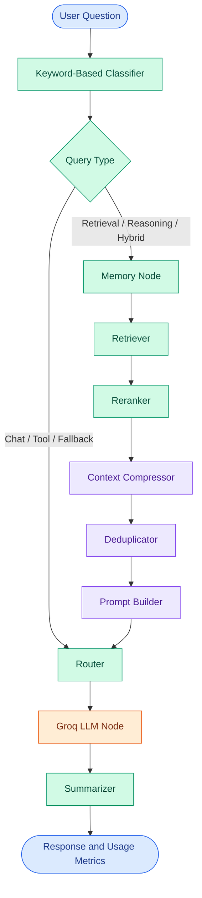

# Token Cost Agent

<p align="center">
  <strong>Context Engineering · LLM Workflow Optimization · Token Usage Analysis</strong>
  <br>
  A modular Python application for exploring more efficient large language model workflows.
</p>

<p align="center">
  <a href="https://github.com/maahii-in/token-cost-cutting">
    
  </a>
  <a href="https://github.com/maahii-in/token-cost-cutting">
    
  </a>
  <a href="https://groq.com/">
    
  </a>
  <a href="https://github.com/maahii-in/token-cost-cutting/stargazers">
    
  </a>
  <a href="https://github.com/maahii-in/token-cost-cutting/commits/main">
    
  </a>
</p>

<p align="center">
  <a href="#overview">Overview</a> ·
  <a href="#features">Features</a> ·
  <a href="#architecture">Architecture</a> ·
  <a href="#getting-started">Getting Started</a> ·
  <a href="#evaluation">Evaluation</a> ·
  <a href="#roadmap">Roadmap</a>
</p>

---

## Table of Contents

- [Overview](#overview)
- [Problem Statement](#problem-statement)
- [Features](#features)
- [Technology Stack](#technology-stack)
- [Architecture](#architecture)
- [Workflow Details](#workflow-details)
- [Project Structure](#project-structure)
- [Getting Started](#getting-started)
- [Configuration](#configuration)
- [Running the Application](#running-the-application)
- [Testing](#testing)
- [Evaluation](#evaluation)
- [Limitations](#limitations)
- [Troubleshooting](#troubleshooting)
- [Roadmap](#roadmap)
- [Contributing](#contributing)
- [Security](#security)
- [Maintainer](#maintainer)

## Overview

**Token Cost Agent** is a Python-based application that explores token-aware processing in large language model (LLM) workflows.

Built using [LangGraph](https://langchain-ai.github.io/langgraph/), the application organizes query classification, memory processing, document retrieval, reranking, context compression, deduplication, prompt construction, response generation, and summarization into specialized nodes.

A shared Pydantic state carries information between these nodes, while token-related metrics provide visibility into parts of the execution.

The project is intended as a foundation for experimenting with context engineering and evaluating how prompt-processing strategies affect token consumption, response quality, and latency.

### Project objectives

- Structure complex LLM workflows into modular processing stages.
- Route questions using a query-classification component.
- Retrieve and prioritize context for retrieval-oriented requests.
- Process retrieved information before prompt construction.
- Track token-related information by workflow node.
- Establish a foundation for reproducible optimization experiments.

> **Project status:** Under development. No specific token savings, cost reductions, or quality improvements are claimed without measured evidence.

## Problem Statement

LLM applications can process unnecessary context when prompts contain irrelevant documents, repeated information, or more text than the task requires.

This can increase input-token usage, cost, and processing time. Aggressive compression, however, can also remove information needed for a correct answer.

Token Cost Agent explores context-processing stages that can be investigated and measured independently.

| Engineering challenge | Project approach |
|---|---|
| Questions need different processing paths | Query classification and conditional routing |
| Retrieved documents may vary in relevance | Retrieval and reranking |
| Context may exceed useful prompt limits | Context-compression stage |
| Documents may contain repeated information | Deduplication stage |
| Workflow state must be shared between components | Pydantic `AgentState` |
| Token usage needs visibility | Per-node token metrics |
| Optimization needs objective evaluation | Baseline-versus-optimized benchmarking |

The key engineering goal is to reduce unnecessary processing **without sacrificing response quality**.

## Features

### 1. Query classification

The classifier uses keyword-based rules to categorize questions into supported types:

- `chat`
- `retrieval`
- `reasoning`
- `tool`
- `hybrid`

The classification result determines which branch of the LangGraph workflow executes. This is a rule-based classifier, not an independently trained model.

### 2. Context retrieval and refinement

The retrieval-oriented branch contains dedicated nodes for memory, document retrieval, reranking, compression, and deduplication.

This separation makes individual stages easier to maintain and evaluate.

### 3. LLM response generation

The application uses the Groq Python SDK to send prompts to the configured language model.

The default model is configured in `config.py` and can be changed through environment-based settings.

### 4. Shared workflow state

The `AgentState` model carries the question, query type, memories, document collections, prompt, response, token metrics, and metadata across workflow nodes.

### 5. Token-related metrics

The application records available metrics in its shared state and prints them by node after processing.

The current LLM node counts prompt and response text locally using the project's token-counting utility. These counts should not automatically be treated as exact provider-reported billing usage.

### 6. Configurable infrastructure

The configuration supports PostgreSQL, Milvus, Redis, embedding models, reranking, retrieval limits, prompt limits, logging, caching, and cost-tracking settings.

Actual service requirements depend on the components being executed.

## Technology Stack

| Technology | Responsibility |
|---|---|
| Python | Core application |
| LangGraph | Stateful graph orchestration |
| LangChain | LLM application components |
| Groq SDK | Language-model API integration |
| PostgreSQL | Relational database client |
| Milvus | Vector database integration |
| Redis | Cache integration |
| Sentence Transformers | Embedding and reranking model support |
| `tiktoken` | Token-counting dependency |
| Pydantic | Structured data validation |
| Pydantic Settings | Environment-based configuration |
| pytest | Test execution |

### Configured models

| Component | Default |
|---|---|
| Language model | `llama-3.3-70b-versatile` |
| Embedding model | `BAAI/bge-small-en-v1.5` |
| Reranking model | `BAAI/bge-reranker-base` |

These are configuration defaults, not claims that every model has been benchmarked or that every integration is required for every execution path.

## Architecture

The workflow is defined in `graph.py` using LangGraph's `StateGraph` and the shared `AgentState` model.



### Routing behavior

The current routing logic in `graph.py` works as follows:

| Query type | Execution path |
|---|---|
| `chat` | Router → LLM → Summarizer |
| `tool` | Router → LLM → Summarizer |
| `retrieval` | Memory → Retriever → Reranker → Compressor → Deduplicator → Prompt Builder → Router → LLM → Summarizer |
| `reasoning` | Memory → Retriever → Reranker → Compressor → Deduplicator → Prompt Builder → Router → LLM → Summarizer |
| `hybrid` | Memory → Retriever → Reranker → Compressor → Deduplicator → Prompt Builder → Router → LLM → Summarizer |
| Other classification values | Router → LLM → Summarizer |

The classifier relies on keyword matching, so its output may not always reflect the user's actual intent. Classification quality is a potential area for future improvement.

### Shared state model

The state definitions in `state.py` provide two principal data structures.

**`Document`**

Represents a retrieved document with:

- A document identifier.
- Text content.
- A relevance score.
- Source information.
- Additional metadata.
- An optional embedding vector.

**`AgentState`**

Represents the current workflow state with:

- `question`
- `query_type`
- `memories`
- `retrieved_docs`
- `reranked_docs`
- `compressed_docs`
- `prompt`
- `response`
- `token_usage`
- `metadata`

Each node receives the shared state, updates its relevant fields, and returns the updated state.

## Project Structure

```text
token-cost-cutting/
│
├── common/                 # Shared utilities and logging
├── db/                     # Database clients and integrations
├── nodes/                  # Specialized LangGraph nodes
├── prompts/                # Prompt templates
├── tests/                  # Test-related files
│
├── app.py                  # Interactive terminal entry point
├── config.py               # Centralized application settings
├── graph.py                # LangGraph workflow definition
├── state.py                # Document and agent state models
│
├── test_db.py              # Database test module
├── test_milvus.py          # Milvus test module
├── requirements.txt        # Python dependencies
└── .gitignore              # Git exclusions
```

## Getting Started

### Prerequisites

Install or configure the following:

- Python and pip.
- Git.
- A valid Groq API key.
- PostgreSQL credentials.
- Any additional services needed by the execution path you intend to use.

Milvus and Redis may require separate service setup. Database schema initialization and collection initialization depend on the corresponding implementation.

### Step 1: Clone the repository

```bash
git clone https://github.com/maahii-in/token-cost-cutting.git
cd token-cost-cutting
```

### Step 2: Create a virtual environment

**Windows PowerShell**

```powershell
python -m venv .venv
.\.venv\Scripts\Activate.ps1
```

**macOS or Linux**

```bash
python3 -m venv .venv
source .venv/bin/activate
```

### Step 3: Install dependencies

```bash
python -m pip install --upgrade pip
pip install -r requirements.txt
```

The requirements include machine-learning packages that may download model files on first use. Installation time, memory requirements, and compatibility depend on your environment.

### Step 4: Configure environment variables

Create a file named `.env` in the project root.

```dotenv
# Application
APP_NAME=Token Cost Agent
APP_ENV=development
APP_DEBUG=true

# Groq
GROQ_API_KEY=your_groq_api_key
GROQ_MODEL=llama-3.3-70b-versatile

# PostgreSQL
POSTGRES_HOST=localhost
POSTGRES_PORT=5432
POSTGRES_DB=token_cost_agent
POSTGRES_USER=postgres
POSTGRES_PASSWORD=your_database_password

# Milvus
MILVUS_HOST=localhost
MILVUS_PORT=19530
MILVUS_COLLECTION=documents

# Redis
REDIS_HOST=localhost
REDIS_PORT=6379
REDIS_DB=0
```

These values reflect the defaults declared in the current configuration. Review `config.py` for all settings and confirm that your local variable names match the code.

`GROQ_API_KEY` and `POSTGRES_PASSWORD` are required by the current settings definition. Because settings are initialized during application imports, provide valid values even if you initially intend to exercise only a path that does not query PostgreSQL.

Never commit real credentials to GitHub.

### Step 5: Verify the setup

Check the Python version:

```bash
python --version
```

Confirm that dependencies install successfully:

```bash
pip check
```

Then verify that the required service credentials and endpoints are available before running the application.

## Configuration

Settings are centralized in `config.py` and loaded through Pydantic Settings from environment variables and the `.env` file.

| Setting | Default | Description |
|---|---|---|
| `APP_NAME` | `Token Cost Agent` | Application name |
| `APP_ENV` | `development` | Runtime environment |
| `APP_DEBUG` | `True` | Debug setting |
| `GROQ_API_KEY` | Required | Groq API key |
| `GROQ_MODEL` | `llama-3.3-70b-versatile` | Language-model identifier |
| `POSTGRES_HOST` | `localhost` | PostgreSQL host |
| `POSTGRES_PORT` | `5432` | PostgreSQL port |
| `POSTGRES_DB` | `token_cost_agent` | Database name |
| `POSTGRES_USER` | `postgres` | Database user |
| `POSTGRES_PASSWORD` | Required | Database password |
| `MILVUS_HOST` | `localhost` | Milvus host |
| `MILVUS_PORT` | `19530` | Milvus port |
| `MILVUS_COLLECTION` | `documents` | Vector collection |
| `REDIS_HOST` | `localhost` | Redis host |
| `REDIS_PORT` | `6379` | Redis port |
| `REDIS_DB` | `0` | Redis database index |
| `EMBEDDING_MODEL` | `BAAI/bge-small-en-v1.5` | Embedding model |
| `RERANKER_MODEL` | `BAAI/bge-reranker-base` | Reranking model |
| `TOP_K` | `10` | Retrieval result limit |
| `RERANK_TOP_K` | `5` | Reranked result limit |
| `SIMILARITY_THRESHOLD` | `0.75` | Similarity threshold |
| `MAX_DOCUMENT_TOKENS` | `300` | Document token limit |
| `MAX_PROMPT_TOKENS` | `4000` | Prompt token limit |
| `LOG_LEVEL` | `INFO` | Logging level |
| `LOG_FILE` | `logs/agent.log` | Log file path |
| `ENABLE_TOKEN_LOGGING` | `True` | Token logging flag |
| `ENABLE_COST_TRACKING` | `True` | Cost tracking flag |
| `CHECKPOINT_PATH` | `checkpoints/` | Checkpoint path |
| `CACHE_TTL` | `3600` | Cache time-to-live |
| `HOST` | `0.0.0.0` | Configured host |
| `PORT` | `8000` | Configured port |

These are configuration values, not a guarantee that every corresponding service or feature is exercised by `app.py`. The current entry point is an interactive CLI; the `HOST` and `PORT` settings do not themselves start an HTTP server.

For authoritative details, refer to [`config.py`](config.py).

## Running the Application

Run the CLI from the repository root:

```bash
python app.py
```

Enter a question at the prompt.

```text
Question > How can I reduce unnecessary context in an LLM prompt?
```

The application invokes the graph and displays an `ANSWER` section followed by `TOKEN USAGE` information recorded in the resulting state.

To exit, enter:

```text
exit
```

The commands `quit` and `q` are also supported. Press `Ctrl+C` to interrupt execution.

### Example output format

```text
============================================================
TOKEN COST AGENT
============================================================

Question > [Your question]

============================================================
ANSWER
============================================================

[Generated response]

============================================================
TOKEN USAGE
============================================================

[Workflow node]
[Available metrics]
```

This is an illustrative output format, not captured execution output. Actual results depend on provider access, configuration, and workflow execution.

## Testing

The repository includes test modules for database and Milvus functionality.

Run the available test suite:

```bash
pytest
```

Run individual modules:

```bash
pytest -v test_db.py
pytest -v test_milvus.py
```

For additional detail:

```bash
pytest -vv
```

Some tests may need reachable external services, credentials, initialized collections, or test data.

Test execution and coverage have not been reported here. Run the suite in your environment to establish the current results.

## Evaluation

Token optimization should be assessed empirically rather than inferred from the presence of compression or deduplication nodes.

A credible evaluation compares a baseline workflow with an optimized workflow using the same dataset, model settings, and task requirements.

### Recommended metrics

| Metric | Evaluation purpose |
|---|---|
| Input tokens | Quantify the prompt tokens sent to the model |
| Output tokens | Quantify generated response tokens |
| Context tokens before processing | Establish the baseline context size |
| Context tokens after processing | Measure the result of context refinement |
| Estimated request cost | Estimate model cost from applicable pricing |
| Response quality | Check relevance, correctness, and usefulness |
| End-to-end latency | Measure total processing time |

### Benchmark methodology

1. Prepare a fixed set of representative questions and source documents.
2. Run a baseline without the optimization being evaluated.
3. Run the optimized configuration on the same inputs.
4. Record input and output token usage for both runs.
5. Evaluate response quality using consistent criteria.
6. Compare token consumption, estimated cost, and latency.
7. Document the model, dataset, configuration, and test conditions.

### Token reduction formula

When comparable baseline and optimized measurements are available:

\[
\text{Token Reduction (\%)} =
\frac{\text{Baseline Tokens} - \text{Optimized Tokens}}
{\text{Baseline Tokens}} \times 100
\]

Use actual provider usage metadata when available for billing analysis. A local tokenizer count is useful for estimating text size, but it may differ from a provider's billing count because of model-specific tokenization and message framing.

No measured token-saving percentage is claimed in this README.

## Limitations

The current implementation has several important considerations:

- **Keyword-based classification:** Classification is rule-based and may not always identify the user's intent correctly.
- **Token-counting accuracy:** Locally counted prompt and response text tokens should not automatically be equated with provider billing usage.
- **External dependencies:** Runtime behavior depends on available credentials, services, installed packages, and model access.
- **Evaluation required:** Context compression may affect answer quality as well as token count.
- **Service configuration:** Declared PostgreSQL, Milvus, and Redis settings do not by themselves establish that those services are running or fully initialized.
- **CLI-focused execution:** The application entry point runs an interactive terminal loop; configured API host and port values do not create a web interface by themselves.

These limitations are also opportunities for future engineering improvements.

## Troubleshooting

| Problem | Suggested checks |
|---|---|
| Missing configuration error | Check required fields in `.env` and `config.py`. |
| Groq authentication failure | Verify `GROQ_API_KEY` and account access. |
| Database connection failure | Verify PostgreSQL availability, database name, host, port, and credentials. |
| Milvus connection error | Check the service endpoint and collection initialization. |
| Redis connection error | Confirm Redis is reachable at the configured endpoint. |
| Model initialization failure | Verify package compatibility, model availability, network access, and available resources. |
| Test failures | Read the traceback and confirm external test dependencies are available. |
| Unexpected query routing | Inspect `ClassifierNode` and `route_after_classifier` in `graph.py`. |
| Unexpected token totals | Check the counting utility and distinguish local counts from provider usage. |

## Roadmap

Potential future improvements:

- [ ] Add reproducible baseline-versus-optimized benchmarks.
- [ ] Compare context size before and after each refinement stage.
- [ ] Report actual provider usage alongside local token estimates.
- [ ] Improve query classification beyond keyword matching.
- [ ] Measure response quality alongside token reduction.
- [ ] Expand node-level unit and integration tests.
- [ ] Improve startup validation and service health checks.
- [ ] Improve structured logging and cost reporting.
- [ ] Document database provisioning and deployment.
- [ ] Add continuous integration for automated testing.

These items are proposed future work, not claims about features already implemented.

## Contributing

Contributions, bug reports, and technical suggestions are welcome.

1. Fork the repository.
2. Create a branch for your change.
3. Implement the change and add relevant tests.
4. Run the applicable test suite.
5. Submit a pull request describing the purpose and impact of your change.

```bash
git checkout -b feature/your-change
git add .
git commit -m "Describe your change"
git push origin feature/your-change
```

Keep pull requests focused and include reproduction steps for bug fixes where appropriate.

## Security

- Never commit API keys or database credentials.
- Use environment variables or an appropriate secrets manager.
- Use separate development credentials for testing.
- Avoid logging sensitive user questions or retrieved document content.
- Restrict network access to databases and cache services.
- Review dependency compatibility and security advisories before upgrading packages.
- Remove exposed credentials from the provider or service if they are accidentally published.

## Maintainer

**Mahi Budati**

- GitHub: [@maahii-in](https://github.com/maahii-in)
- Repository: [token-cost-cutting](https://github.com/maahii-in/token-cost-cutting)

---

<p align="center">
  <strong>Token Cost Agent</strong>
  <br>
  <sub>Python · LangGraph · Context Engineering · LLM Applications</sub>
  <br><br>
  <a href="#token-cost-agent">Back to top ↑</a>
</p>
