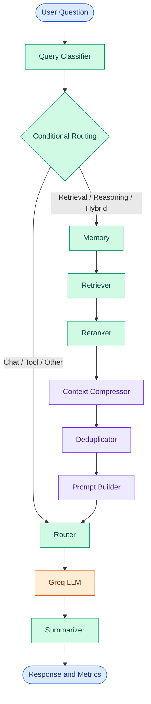

# Token Cost Agent

<p align="center">
  <strong>Engineering More Efficient LLM Workflows</strong>
  <br>
  Context Engineering · Retrieval Pipelines · Token Usage Analysis
  <br><br>
  A modular Python application that explores how intelligent context processing can improve the efficiency of large language model applications.
</p>

<p align="center">
  <a href="https://github.com/maahii-in/token-cost-cutting">
    
  </a>
  <a href="https://github.com/maahii-in/token-cost-cutting">
    
  </a>
  <a href="https://groq.com/">
    
  </a>
  <a href="https://github.com/maahii-in/token-cost-cutting/stargazers">
    
  </a>
  <a href="https://github.com/maahii-in/token-cost-cutting/commits/main">
    
  </a>
</p>

<p align="center">
  <a href="#overview">Overview</a> ·
  <a href="#system-design">System Design</a> ·
  <a href="#installation">Installation</a> ·
  <a href="#evaluation">Evaluation</a> ·
  <a href="#contributing">Contributing</a>
</p>

---

## Table of Contents

- [Overview](#overview)
- [Problem Statement](#problem-statement)
- [Engineering Objectives](#engineering-objectives)
- [Key Features](#key-features)
- [Technology Stack](#technology-stack)
- [System Design](#system-design)
- [Workflow Execution](#workflow-execution)
- [Project Structure](#project-structure)
- [Installation](#installation)
- [Configuration](#configuration)
- [Running the Application](#running-the-application)
- [Testing](#testing)
- [Evaluation](#evaluation)
- [Known Limitations](#known-limitations)
- [Troubleshooting](#troubleshooting)
- [Roadmap](#roadmap)
- [Contributing](#contributing)
- [Security](#security)
- [Maintainer](#maintainer)

## Overview

**Token Cost Agent** is a Python-based project focused on context engineering and token-aware processing for large language model (LLM) workflows.

The application uses **LangGraph** to coordinate specialized processing nodes responsible for query classification, memory, document retrieval, reranking, context compression, deduplication, prompt construction, response generation, and summarization.

A shared Pydantic state carries data between the nodes, while token-related metrics provide visibility into the processing pipeline.

The central idea is straightforward:

> Send the model the context it needs, avoid unnecessary repetition, and measure the impact of optimization.

The project is designed as an extensible foundation for studying the relationship between context selection, prompt size, response quality, latency, and LLM request costs.

### Project status

**Under development.** The repository contains the core workflow and supporting configuration, but measured token savings, benchmark results, and production readiness should be established through testing.

## Problem Statement

LLM applications can consume unnecessary input tokens when prompts contain irrelevant information, duplicate documents, or oversized context windows.

However, indiscriminate compression can remove important details and reduce answer quality. Token reduction must therefore be evaluated alongside relevance and correctness.

Token Cost Agent explores a staged approach:

| Challenge | Engineering approach |
|---|---|
| Different query types require different processing | Rule-based classification and conditional routing |
| Retrieved information may be irrelevant | Retrieval and reranking stages |
| Context may be unnecessarily large | Context compression |
| Repeated information may waste prompt space | Deduplication |
| Processing logic can become difficult to maintain | Modular LangGraph nodes |
| Usage metrics can be difficult to inspect | Shared state and per-node metrics |
| Optimization can introduce quality regressions | Baseline-versus-optimized evaluation |

## Engineering Objectives

The project follows several engineering principles:

- **Separation of concerns:** Keep classification, retrieval, compression, prompting, and generation in separate nodes.
- **Explicit state:** Use a typed shared state to pass information between workflow stages.
- **Configurable behavior:** Centralize provider credentials, model identifiers, retrieval thresholds, and token limits.
- **Observable execution:** Record available metrics and log relevant workflow activity.
- **Evidence-based optimization:** Measure token consumption and response quality instead of assuming that an optimization is beneficial.
- **Incremental development:** Make it possible to test and improve individual stages independently.

## Key Features

### Query classification

The classifier uses keyword-based rules to categorize user input into supported query types:

- `chat`
- `retrieval`
- `reasoning`
- `tool`
- `hybrid`

The classification result determines which route is selected in the graph. The current implementation is rule-based rather than a trained intent-classification model.

### Retrieval and context refinement

The retrieval-oriented branch includes distinct nodes for:

1. Memory processing
2. Document retrieval
3. Document reranking
4. Context compression
5. Deduplication
6. Prompt construction

This structure separates information retrieval from subsequent context processing and response generation.

### LLM response generation

The LLM node uses the Groq Python SDK and the model selected through application configuration.

The current generation settings include a temperature of `0.2` and a maximum generation length of `1024` tokens.

### Token usage visibility

The application records token-related information in the shared workflow state and prints the available metrics after producing a response.

The current LLM node counts the prompt text and response text locally. These values are useful for text-size analysis, but they are not automatically equivalent to the provider's official billing usage.

### Centralized configuration

Pydantic Settings manages configuration for:

- Groq credentials and model selection
- PostgreSQL, Milvus, and Redis connections
- Embedding and reranking models
- Retrieval and compression limits
- Logging and caching
- Token logging and cost-tracking settings

### Shared state management

The `AgentState` model provides structured fields for the question, query category, memories, document collections, prompt, response, token usage, and metadata.

This gives each node a common representation of the workflow's current data.

## Technology Stack

| Technology | Role |
|---|---|
| Python | Application implementation |
| LangGraph | Stateful graph orchestration |
| LangChain | LLM application components |
| Groq SDK | LLM API integration |
| PostgreSQL | Relational database integration |
| Milvus | Vector database integration |
| Redis | Cache integration |
| Sentence Transformers | Embedding and reranking model support |
| `tiktoken` | Token-counting utilities |
| Pydantic | Structured state validation |
| Pydantic Settings | Environment-based configuration |
| pytest | Automated testing |

### Model configuration

The current configuration declares the following defaults:

| Component | Default |
|---|---|
| LLM | `llama-3.3-70b-versatile` |
| Embeddings | `BAAI/bge-small-en-v1.5` |
| Reranker | `BAAI/bge-reranker-base` |

Actual model availability depends on the provider, package versions, network access, and runtime environment.

## System Design

The workflow is defined in `graph.py` using LangGraph's `StateGraph`.



### Conditional routing

The current routing function in `graph.py` selects the execution path using `state.query_type`.

| Query type | Route |
|---|---|
| `chat` | Router → LLM → Summarizer |
| `tool` | Router → LLM → Summarizer |
| `retrieval` | Memory → Retrieval pipeline → Router → LLM → Summarizer |
| `reasoning` | Memory → Retrieval pipeline → Router → LLM → Summarizer |
| `hybrid` | Memory → Retrieval pipeline → Router → LLM → Summarizer |
| Other values | Router → LLM → Summarizer |

In the retrieval-oriented route, the retrieval pipeline consists of the retriever, reranker, compressor, deduplicator, and prompt builder.

The keyword classifier's rules and the graph's routing rules are separate concerns. For example, a query assigned the `reasoning` type is routed through memory even if the question does not contain an explicitly retrieval-oriented term.

### Shared state model

The project defines two principal Pydantic models in `state.py`.

**`Document`**

| Field | Purpose |
|---|---|
| `id` | Document identifier |
| `content` | Document text |
| `score` | Relevance score |
| `source` | Document source |
| `metadata` | Additional document attributes |
| `embedding` | Optional embedding vector |

**`AgentState`**

| Field | Purpose |
|---|---|
| `question` | User input |
| `query_type` | Classifier output |
| `memories` | Stored or retrieved memory strings |
| `retrieved_docs` | Retrieved documents |
| `reranked_docs` | Reranked document collection |
| `compressed_docs` | Processed document collection |
| `prompt` | Constructed LLM prompt |
| `response` | Generated response |
| `token_usage` | Per-node metrics |
| `metadata` | Additional workflow information |

Each node receives the state, updates its relevant fields, and returns the updated state.

## Project Structure

```text
token-cost-cutting/
│
├── common/                 # Shared utilities, logging, token counting
├── db/                     # Database integration modules
├── nodes/                  # Specialized workflow nodes
├── prompts/                # Prompt templates
├── tests/                  # Test-related modules
│
├── app.py                  # Interactive CLI entry point
├── config.py               # Application configuration
├── graph.py                # LangGraph workflow definition
├── state.py                # Document and agent state models
│
├── test_db.py              # Database test module
├── test_milvus.py          # Milvus test module
├── requirements.txt        # Python dependencies
└── .gitignore              # Git exclusions
```

## Installation

### Prerequisites

- Python and pip
- Git
- A valid Groq API key
- PostgreSQL credentials
- Any supporting services required by the chosen workflow

PostgreSQL, Milvus, and Redis may need independent setup. Confirm the initialization requirements of their respective integration modules.

### 1. Clone the repository

```bash
git clone https://github.com/maahii-in/token-cost-cutting.git
cd token-cost-cutting
```

### 2. Create a virtual environment

**Windows PowerShell**

```powershell
python -m venv .venv
.\.venv\Scripts\Activate.ps1
```

**macOS / Linux**

```bash
python3 -m venv .venv
source .venv/bin/activate
```

### 3. Install dependencies

```bash
python -m pip install --upgrade pip
pip install -r requirements.txt
```

Verify the installed dependency environment:

```bash
pip check
```

Machine-learning dependencies may download model files at first use and require additional memory or disk space.

### 4. Create the environment file

Create a `.env` file in the project root:

```dotenv
# Application
APP_NAME=Token Cost Agent
APP_ENV=development
APP_DEBUG=true

# Groq
GROQ_API_KEY=your_groq_api_key
GROQ_MODEL=llama-3.3-70b-versatile

# PostgreSQL
POSTGRES_HOST=localhost
POSTGRES_PORT=5432
POSTGRES_DB=token_cost_agent
POSTGRES_USER=postgres
POSTGRES_PASSWORD=your_database_password

# Milvus
MILVUS_HOST=localhost
MILVUS_PORT=19530
MILVUS_COLLECTION=documents

# Redis
REDIS_HOST=localhost
REDIS_PORT=6379
REDIS_DB=0
```

These values follow the settings declared in `config.py`. Review that file for all available fields before launching the application.

Both `GROQ_API_KEY` and `POSTGRES_PASSWORD` are required by the current settings model. Since settings are initialized during imports, both must be provided even when initially testing a route that does not access PostgreSQL.

**Never commit real credentials or your `.env` file to version control.**

## Configuration

Application settings are centralized in `config.py` and loaded through Pydantic Settings.

| Setting | Default | Description |
|---|---|---|
| `APP_NAME` | `Token Cost Agent` | Application name |
| `APP_ENV` | `development` | Environment selection |
| `APP_DEBUG` | `True` | Debug configuration |
| `GROQ_API_KEY` | Required | Groq API key |
| `GROQ_MODEL` | `llama-3.3-70b-versatile` | Model identifier |
| `POSTGRES_HOST` | `localhost` | Database host |
| `POSTGRES_PORT` | `5432` | Database port |
| `POSTGRES_DB` | `token_cost_agent` | Database name |
| `POSTGRES_USER` | `postgres` | Database user |
| `POSTGRES_PASSWORD` | Required | Database password |
| `MILVUS_HOST` | `localhost` | Milvus host |
| `MILVUS_PORT` | `19530` | Milvus port |
| `MILVUS_COLLECTION` | `documents` | Vector collection |
| `REDIS_HOST` | `localhost` | Redis host |
| `REDIS_PORT` | `6379` | Redis port |
| `REDIS_DB` | `0` | Redis database index |
| `EMBEDDING_MODEL` | `BAAI/bge-small-en-v1.5` | Embedding model |
| `RERANKER_MODEL` | `BAAI/bge-reranker-base` | Reranking model |
| `TOP_K` | `10` | Retrieval result limit |
| `RERANK_TOP_K` | `5` | Reranked result limit |
| `SIMILARITY_THRESHOLD` | `0.75` | Similarity threshold |
| `MAX_DOCUMENT_TOKENS` | `300` | Document token limit |
| `MAX_PROMPT_TOKENS` | `4000` | Prompt token limit |
| `LOG_LEVEL` | `INFO` | Logging level |
| `LOG_FILE` | `logs/agent.log` | Log destination |
| `ENABLE_TOKEN_LOGGING` | `True` | Token logging flag |
| `ENABLE_COST_TRACKING` | `True` | Cost tracking flag |
| `CHECKPOINT_PATH` | `checkpoints/` | Checkpoint path |
| `CACHE_TTL` | `3600` | Cache time-to-live |
| `HOST` | `0.0.0.0` | Configured host |
| `PORT` | `8000` | Configured port |

These settings describe the configuration model. They do not imply that every integration is exercised by the CLI entry point.

**Runtime note:** The current `app.py` launches an interactive terminal application. Defining `HOST` and `PORT` does not by itself create a web server.

## Running the Application

From the repository root, execute:

```bash
python app.py
```

Enter a question when prompted:

```text
Question > How can I reduce unnecessary context in an LLM prompt?
```

The application invokes the compiled LangGraph workflow and displays the generated answer and available token-usage metrics.

To exit:

```text
exit
```

You can also enter `quit` or `q`, or press `Ctrl+C`.

### Illustrative output

```text
============================================================
TOKEN COST AGENT
============================================================

Question > [Your question]

============================================================
ANSWER
============================================================

[Generated response]

============================================================
TOKEN USAGE
============================================================

[Recorded metrics by workflow node]
```

This is an example of the output format, not a captured execution result. Actual output depends on service availability, credentials, and successful workflow execution.

## Testing

Run the available test suite:

```bash
pytest
```

Run the database-related modules individually:

```bash
pytest -v test_db.py
pytest -v test_milvus.py
```

For more detailed output:

```bash
pytest -vv
```

Tests may require valid connection settings, running external services, and initialized test data.

For meaningful quality assurance, test individual nodes as well as end-to-end graph execution. Record test results and coverage from actual runs rather than inferring them from the presence of test modules.

## Evaluation

The project aims to investigate token efficiency, but an optimization stage should only be considered effective when its impact is measured.

### Evaluation dimensions

| Metric | What it measures |
|---|---|
| Input tokens | Text tokens supplied to the model |
| Output tokens | Text tokens generated by the model |
| Context size before processing | Baseline context size |
| Context size after processing | Context size after optimization |
| Estimated request cost | Cost calculated from applicable model pricing |
| Response quality | Relevance, accuracy, and completeness |
| End-to-end latency | Time needed to complete the workflow |

### Recommended benchmark procedure

1. Create a fixed dataset of representative queries and relevant documents.
2. Run an explicitly defined baseline workflow.
3. Run the optimized workflow with the same inputs and model.
4. Record token usage using consistent counting methods.
5. Evaluate answer quality using the same criteria.
6. Compare token consumption, request cost estimates, and latency.
7. Document the dataset, model, configuration, and test conditions.

### Token reduction

When comparable baseline and optimized measurements are available:

\[
\text{Reduction (\%)} =
\frac{\text{Baseline Tokens} - \text{Optimized Tokens}}
{\text{Baseline Tokens}} \times 100
\]

Calculate input and output reductions separately when appropriate.

### Important distinction: local tokens and billed usage

The current `LLMNode` uses `count_tokens()` on the constructed prompt and generated response. It does not directly use the provider's reported usage object for these recorded counts. The count of the constructed prompt also does not automatically include every token associated with system instructions or provider-side message framing.

Consequently, these metrics should be treated as **local text-token estimates**, not exact billing measurements.

For production cost analysis, capture the model provider's actual input and output usage metadata where available, and calculate cost using the applicable model pricing.

No token-reduction percentage or cost-saving result is claimed without experimental evidence.

## Known Limitations

- **Rule-based classification:** Keyword matching may misclassify ambiguous questions.
- **Context quality:** Compression and deduplication can remove information if their implementations are not sufficiently careful.
- **Token measurement:** Local token counts may differ from provider-reported billing usage.
- **External services:** Integrations depend on service availability, credentials, and configuration.
- **Execution scope:** The current application entry point is a CLI, not a deployed HTTP API.
- **Benchmarking:** Reproducible baseline comparisons are needed to quantify improvements.
- **Operational readiness:** Deployment, observability, and service initialization should be verified independently before production use.

## Troubleshooting

| Problem | Recommended checks |
|---|---|
| Settings validation fails | Confirm required fields in `.env` and `config.py`. |
| Groq authentication fails | Verify the API key and provider access. |
| PostgreSQL connection fails | Check the host, port, database, username, password, and service status. |
| Milvus initialization fails | Verify endpoint availability and collection setup. |
| Redis connection fails | Check the service and connection settings. |
| Model initialization fails | Review installed package compatibility, network access, and resource availability. |
| Unexpected route | Inspect the classifier rules and `route_after_classifier()` in `graph.py`. |
| Token counts differ from API usage | Compare local tokenizer results with provider-reported usage metadata. |
| Tests fail | Review tracebacks, service prerequisites, and test data. |

## Roadmap

Potential engineering improvements:

- [ ] Implement reproducible baseline-versus-optimized benchmarks.
- [ ] Capture actual provider-reported token usage.
- [ ] Separate estimated cost from verified provider usage.
- [ ] Add token and context measurements before and after each optimization stage.
- [ ] Improve query classification and routing evaluation.
- [ ] Measure response quality alongside token reduction.
- [ ] Expand unit and integration tests.
- [ ] Add startup checks for required dependencies and services.
- [ ] Improve structured logging and error reporting.
- [ ] Document database provisioning and deployment.
- [ ] Add automated testing through continuous integration.

These are proposed improvements, not claims that the functionality is already implemented.

## Contributing

Contributions, bug reports, and technical suggestions are welcome.

1. Fork the repository.
2. Create a branch for your change.
3. Implement the change and add appropriate tests.
4. Run the relevant test suite.
5. Submit a pull request explaining the change and how it was tested.

```bash
git checkout -b feature/your-change
git add .
git commit -m "Describe your change"
git push origin feature/your-change
```

Keep contributions focused and avoid including credentials, generated model files, or unrelated changes.

## Security

- Keep API keys and database passwords out of source control.
- Use environment variables or an appropriate secrets manager.
- Use dedicated development credentials for local testing.
- Avoid logging sensitive queries and retrieved documents.
- Restrict network access to databases and cache services.
- Review dependency compatibility and security advisories.
- Rotate exposed credentials immediately if they are accidentally committed.

## Maintainer

**Mahi Budati**

[GitHub Profile](https://github.com/maahii-in) · [Repository](https://github.com/maahii-in/token-cost-cutting)

---

<p align="center">
  <strong>Token Cost Agent</strong>
  <br>
  <sub>Python · LangGraph · Context Engineering · LLM Applications</sub>
  <br><br>
  <a href="#token-cost-agent">Back to top ↑</a>
</p>
