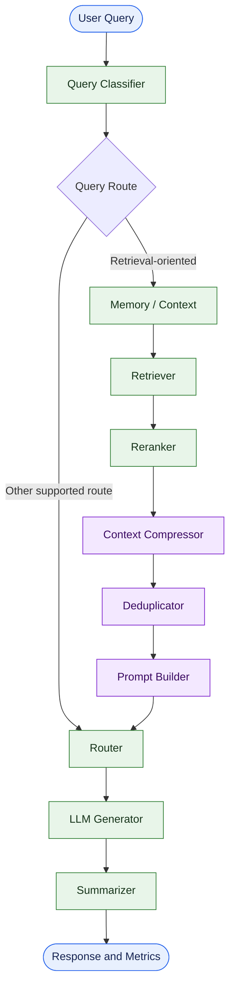

# Token Cost Agent

<p align="center">
  <strong>Building more efficient LLM workflows through intelligent context processing and token usage analysis.</strong>
</p>

<p align="center">
  <a href="https://github.com/maahii-in/token-cost-cutting">
    
  </a>
  <a href="https://github.com/maahii-in/token-cost-cutting">
    
  </a>
  <a href="https://groq.com/">
    
  </a>
  <a href="https://github.com/maahii-in/token-cost-cutting/blob/main/requirements.txt">
    
  </a>
  <a href="https://github.com/maahii-in/token-cost-cutting/stargazers">
    
  </a>
</p>

<p align="center">
  <a href="#overview">Overview</a> ·
  <a href="#features">Features</a> ·
  <a href="#architecture">Architecture</a> ·
  <a href="#installation">Installation</a> ·
  <a href="#configuration">Configuration</a> ·
  <a href="#testing">Testing</a>
</p>

---

## Overview

**Token Cost Agent** is a Python-based project focused on improving the efficiency of large language model (LLM) applications through context processing, retrieval optimization, and token usage tracking.

Built around **LangGraph**, the project separates processing into specialized workflow nodes, allowing individual stages to be maintained, evaluated, and improved independently.

The objective is to investigate how relevant context, structured prompts, and token-aware processing can help reduce unnecessary LLM input while preserving response quality.

### Project objectives

- Reduce redundant and irrelevant prompt context.
- Organize LLM operations into modular workflow components.
- Retrieve and rerank context for relevant queries.
- Apply context compression and deduplication.
- Track available token usage and cost-related metrics.
- Provide a foundation for repeatable efficiency testing.

> **Status:** Under development. Token savings and cost reductions must be established through actual measurements.

## Features

<table>
  <tr>
    <td width="50%" valign="top">
      <h3>Context Processing</h3>
      Organizes retrieval, reranking, compression, and deduplication into separate workflow stages.
    </td>
    <td width="50%" valign="top">
      <h3>Workflow Orchestration</h3>
      Uses LangGraph to define stateful processing and conditional routing.
    </td>
  </tr>
  <tr>
    <td width="50%" valign="top">
      <h3>LLM Integration</h3>
      Connects the application to Groq using a configurable model.
    </td>
    <td width="50%" valign="top">
      <h3>Token Tracking</h3>
      Supports reporting token-related metrics recorded by the workflow.
    </td>
  </tr>
  <tr>
    <td width="50%" valign="top">
      <h3>Data Integrations</h3>
      Provides configuration for PostgreSQL, Milvus, and Redis.
    </td>
    <td width="50%" valign="top">
      <h3>Configurable Components</h3>
      Centralizes application settings, retrieval limits, and model configuration.
    </td>
  </tr>
</table>

## Technology Stack

| Technology | Purpose |
|---|---|
| Python | Application development |
| LangGraph | Workflow orchestration |
| LangChain | LLM application components |
| Groq | Language model provider |
| PostgreSQL | Relational database integration |
| Milvus | Vector database integration |
| Redis | Cache integration |
| Sentence Transformers | Embedding and reranking model support |
| `tiktoken` | Token-counting utilities |
| Pydantic Settings | Configuration management |
| pytest | Automated testing |

## Architecture

The application is organized as a modular workflow, with the graph definition controlling routing between processing nodes.



### Processing pipeline

1. **Classification** — categorize the incoming query.
2. **Retrieval** — retrieve relevant information for supported query types.
3. **Reranking** — prioritize more relevant retrieved documents.
4. **Compression** — process context before prompt construction.
5. **Deduplication** — handle repeated context.
6. **Prompt construction** — prepare the input for response generation.
7. **Generation** — obtain a response from the configured LLM.
8. **Reporting** — display available token usage metrics.

The diagram is a conceptual representation of the workflow. Refer to `graph.py` and the individual nodes for the actual execution logic.

## Project Structure

```text
token-cost-cutting/
│
├── common/               # Shared utilities and helpers
├── db/                   # Database integrations
├── nodes/                # Workflow processing nodes
├── prompts/              # Prompt templates
├── tests/                # Test suite
│
├── app.py                # Application entry point
├── config.py             # Application configuration
├── graph.py              # LangGraph workflow
├── state.py              # Shared workflow state and metrics
│
├── test_db.py            # Database tests
├── test_milvus.py        # Milvus tests
├── requirements.txt      # Python dependencies
└── .gitignore             # Git exclusions
```

## Installation

### Prerequisites

- Python and pip
- Git
- A Groq API key
- Required database and supporting services for the workflow being executed

### 1. Clone the repository

```bash
git clone https://github.com/maahii-in/token-cost-cutting.git
cd token-cost-cutting
```

### 2. Create a virtual environment

**Windows PowerShell**

```powershell
python -m venv .venv
.\.venv\Scripts\Activate.ps1
```

**macOS / Linux**

```bash
python3 -m venv .venv
source .venv/bin/activate
```

### 3. Install dependencies

```bash
python -m pip install --upgrade pip
pip install -r requirements.txt
```

### 4. Configure environment variables

Create a `.env` file in the project root:

```dotenv
# LLM provider
GROQ_API_KEY=your_groq_api_key
GROQ_MODEL=llama-3.3-70b-versatile

# PostgreSQL
POSTGRES_HOST=localhost
POSTGRES_PORT=5432
POSTGRES_DB=token_cost_agent
POSTGRES_USER=postgres
POSTGRES_PASSWORD=your_database_password

# Milvus
MILVUS_HOST=localhost
MILVUS_PORT=19530
MILVUS_COLLECTION=documents

# Redis
REDIS_HOST=localhost
REDIS_PORT=6379
REDIS_DB=0
```

These values follow the project's configuration defaults. Additional settings for embeddings, reranking, retrieval, compression, logging, caching, and cost tracking are defined in `config.py`.

Keep `.env` out of version control. Never publish API keys or database credentials.

### 5. Run the application

```bash
python app.py
```

The application is designed to accept questions in an interactive terminal session.

Example input:

```text
Question > How can I reduce unnecessary context in an LLM prompt?
```

The application then processes the query through its configured workflow.

Actual output depends on successful initialization, service availability, and the implemented processing path.

## Configuration

Settings are centralized in `config.py` and loaded using Pydantic Settings.

| Setting | Default | Description |
|---|---|---|
| `GROQ_MODEL` | `llama-3.3-70b-versatile` | Language model |
| `POSTGRES_HOST` | `localhost` | PostgreSQL host |
| `POSTGRES_PORT` | `5432` | PostgreSQL port |
| `POSTGRES_DB` | `token_cost_agent` | Database name |
| `MILVUS_HOST` | `localhost` | Milvus host |
| `MILVUS_PORT` | `19530` | Milvus port |
| `MILVUS_COLLECTION` | `documents` | Vector collection |
| `REDIS_HOST` | `localhost` | Redis host |
| `REDIS_PORT` | `6379` | Redis port |
| `REDIS_DB` | `0` | Redis database index |
| `EMBEDDING_MODEL` | `BAAI/bge-small-en-v1.5` | Embedding model |
| `RERANKER_MODEL` | `BAAI/bge-reranker-base` | Reranking model |
| `TOP_K` | `10` | Retrieval result limit |
| `RERANK_TOP_K` | `5` | Reranked result limit |
| `SIMILARITY_THRESHOLD` | `0.75` | Similarity threshold |
| `MAX_DOCUMENT_TOKENS` | `300` | Document token limit |
| `MAX_PROMPT_TOKENS` | `4000` | Prompt token limit |
| `ENABLE_TOKEN_LOGGING` | `True` | Token logging setting |
| `ENABLE_COST_TRACKING` | `True` | Cost tracking setting |

For the full configuration, refer to [`config.py`](config.py).

## Testing

Run the available test suite:

```bash
pytest
```

Run specific test modules:

```bash
pytest -v test_db.py
pytest -v test_milvus.py
```

Tests that interact with external services may require configured credentials, running services, and initialized test data.

## Measuring Token Efficiency

Token reduction should be measured rather than assumed.

A useful comparison should evaluate the baseline workflow against the optimized workflow using the same input, model, and quality criteria.

| Metric | Purpose |
|---|---|
| Input token count | Measure prompt size |
| Output token count | Measure generated response size |
| Estimated request cost | Estimate the cost using applicable model pricing |
| Context size before processing | Establish the baseline |
| Context size after processing | Measure context reduction |
| Response quality | Evaluate usefulness and relevance |
| Latency | Measure processing time |

The project's compression and deduplication stages provide starting points for experimentation. No specific cost-saving percentage is claimed without measured benchmark results.

## Roadmap

- [ ] Add reproducible baseline and optimized-workflow comparisons.
- [ ] Improve token and API cost reporting.
- [ ] Benchmark context compression and deduplication.
- [ ] Add response-quality evaluation.
- [ ] Expand unit and integration test coverage.
- [ ] Improve error handling and structured logging.
- [ ] Document database initialization and deployment.

## Contributing

Contributions and suggestions are welcome.

1. Fork the repository.
2. Create a branch for your change.
3. Implement the change and add appropriate tests.
4. Run the relevant tests.
5. Submit a pull request describing your contribution.

## Security

- Store sensitive values in environment variables.
- Do not commit credentials or API keys.
- Use separate development credentials for testing.
- Avoid logging sensitive prompts or retrieved documents.
- Restrict access to databases and supporting services.

## Maintainer

**Mahi Budati**

[GitHub Profile](https://github.com/maahii-in) · [Project Repository](https://github.com/maahii-in/token-cost-cutting)

---

<p align="center">
  <sub>Token Cost Agent · Python · LangGraph · LLM Engineering</sub>
  <br>
  <a href="#token-cost-agent">Back to top ↑</a>
</p>
