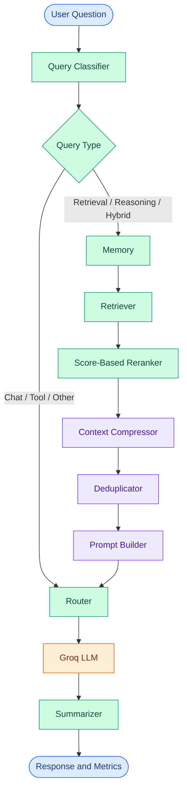

# Token Cost Agent

<p align="center">
  
</p>

<p align="center">
  <strong>Engineering more efficient LLM workflows through context optimization and token-aware processing.</strong>
  <br>
  A modular Python application built with LangGraph and Groq.
</p>

<p align="center">
  <a href="https://github.com/maahii-in/token-cost-cutting">
    
  </a>
  <a href="https://github.com/maahii-in/token-cost-cutting">
    
  </a>
  <a href="https://groq.com/">
    
  </a>
  <a href="https://github.com/maahii-in/token-cost-cutting/stargazers">
    
  </a>
  <a href="https://github.com/maahii-in/token-cost-cutting/commits/main">
    
  </a>
</p>

<p align="center">
  <a href="#overview">Overview</a> ·
  <a href="#features">Features</a> ·
  <a href="#architecture">Architecture</a> ·
  <a href="#installation">Installation</a> ·
  <a href="#evaluation">Evaluation</a>
</p>

---

## Overview

**Token Cost Agent** is a Python-based application that explores token-efficient processing for large language model (LLM) workflows.

Built with [LangGraph](https://langchain-ai.github.io/langgraph/), it organizes query classification, memory processing, document retrieval, reranking, context compression, deduplication, prompt construction, response generation, and summarization into separate workflow nodes.

The project focuses on three objectives:

- **Context efficiency** — reduce unnecessary or repetitive context.
- **Workflow modularity** — separate processing into maintainable components.
- **Usage visibility** — inspect token-related metrics throughout execution.

> **Status:** Under development. Actual token savings and cost reductions must be established through reproducible benchmarks.

## Features

<table>
  <tr>
    <td width="50%" valign="top">
      <strong>01 · Workflow Orchestration</strong>
      <p>Conditional routing and shared state using LangGraph.</p>
    </td>
    <td width="50%" valign="top">
      <strong>02 · Context Retrieval</strong>
      <p>A Milvus integration for retrieving document candidates.</p>
    </td>
  </tr>
  <tr>
    <td width="50%" valign="top">
      <strong>03 · Context Refinement</strong>
      <p>Document selection, text compression, and fuzzy deduplication.</p>
    </td>
    <td width="50%" valign="top">
      <strong>04 · LLM Integration</strong>
      <p>Response generation through the Groq API.</p>
    </td>
  </tr>
  <tr>
    <td width="50%" valign="top">
      <strong>05 · Token Accounting</strong>
      <p>Local token estimates and node-level processing metrics.</p>
    </td>
    <td width="50%" valign="top">
      <strong>06 · Configurable Services</strong>
      <p>Configuration for PostgreSQL, Milvus, Redis, and model settings.</p>
    </td>
  </tr>
</table>

## Technology Stack

| Technology | Purpose |
|---|---|
| Python | Core application |
| LangGraph | Workflow orchestration |
| LangChain | LLM application components |
| Groq SDK | Language-model API |
| PostgreSQL | Relational database integration |
| Milvus | Vector database integration |
| Redis | Memory and cache integration |
| Sentence Transformers | Configured embedding and reranking models |
| RapidFuzz | Fuzzy document similarity |
| `tiktoken` | Local token counting |
| Pydantic Settings | Configuration management |
| pytest | Testing |

## Architecture



### How it works

1. **Classify:** Categorize the incoming question using keyword-based rules.
2. **Route:** Select the appropriate graph branch.
3. **Retrieve:** Load memory and retrieve documents for retrieval-oriented queries.
4. **Refine:** Rank, compress, and deduplicate document content.
5. **Construct:** Build the prompt for the language model.
6. **Generate:** Send the prompt to Groq.
7. **Report:** Return the response and display recorded usage metrics.

The diagram represents the current graph structure. The quality of retrieval depends on the embedding implementation and available indexed data.

## Project Structure

```text
token-cost-cutting/
├── common/             # Shared utilities and token counting
├── db/                 # Database integrations
├── nodes/              # Workflow node implementations
├── prompts/            # Prompt templates
├── tests/              # Test-related modules
│
├── app.py              # Interactive CLI entry point
├── config.py           # Application settings
├── graph.py             # LangGraph workflow
├── state.py             # Shared document and agent state
├── test_db.py           # Database tests
├── test_milvus.py       # Milvus tests
├── requirements.txt     # Dependencies
└── .gitignore           # Git exclusions
```

## Installation

### Prerequisites

- Python 3.10 or newer
- Git
- A Groq API key
- PostgreSQL credentials
- Supporting services required by your chosen workflow

### 1. Clone the repository

```bash
git clone https://github.com/maahii-in/token-cost-cutting.git
cd token-cost-cutting
```

### 2. Create a virtual environment

**Windows PowerShell**

```powershell
python -m venv .venv
.\.venv\Scripts\Activate.ps1
```

**macOS / Linux**

```bash
python3 -m venv .venv
source .venv/bin/activate
```

### 3. Install dependencies

```bash
python -m pip install --upgrade pip
pip install -r requirements.txt
pip check
```

### 4. Configure environment variables

Create a `.env` file in the project root:

```dotenv
GROQ_API_KEY=your_groq_api_key
GROQ_MODEL=llama-3.3-70b-versatile

POSTGRES_HOST=localhost
POSTGRES_PORT=5432
POSTGRES_DB=token_cost_agent
POSTGRES_USER=postgres
POSTGRES_PASSWORD=your_database_password

MILVUS_HOST=localhost
MILVUS_PORT=19530
MILVUS_COLLECTION=documents

REDIS_HOST=localhost
REDIS_PORT=6379
REDIS_DB=0
```

The settings model also defines defaults for retrieval, embeddings, reranking, compression, logging, caching, and token tracking. Review [`config.py`](config.py) for the complete configuration.

Both `GROQ_API_KEY` and `POSTGRES_PASSWORD` are required when the settings model initializes.

**Security:** Never commit your `.env` file, API keys, or database credentials.

## Usage

Start the interactive application:

```bash
python app.py
```

Enter a question when prompted:

```text
Question > How can I reduce unnecessary context in an LLM prompt?
```

The application runs the workflow and displays the generated answer and available token-usage metrics.

To exit, enter `exit`, `quit`, or `q`.

The current application is a terminal interface; the configured `HOST` and `PORT` values do not independently create an HTTP server.

## Configuration

The primary defaults are defined in [`config.py`](config.py).

| Setting | Default |
|---|---|
| `GROQ_MODEL` | `llama-3.3-70b-versatile` |
| `EMBEDDING_MODEL` | `BAAI/bge-small-en-v1.5` |
| `RERANKER_MODEL` | `BAAI/bge-reranker-base` |
| `TOP_K` | `10` |
| `RERANK_TOP_K` | `5` |
| `SIMILARITY_THRESHOLD` | `0.75` |
| `MAX_DOCUMENT_TOKENS` | `300` |
| `MAX_PROMPT_TOKENS` | `4000` |
| `CACHE_TTL` | `3600` |
| `LOG_LEVEL` | `INFO` |

These are declared configuration values. Some settings represent planned integration behavior and are not necessarily used by every current node.

## Implementation Notes

Transparency about implementation status is important for evaluating this project.

| Component | Current behavior |
|---|---|
| Classification | Keyword-based rules |
| Query embedding | Placeholder vector of 768 values |
| Retrieval | Milvus search integration |
| Reranking | Sorts documents by their existing scores |
| Compression | Removes empty and duplicate lines, normalizes whitespace, and truncates text |
| Deduplication | Uses RapidFuzz text similarity |
| Summarization | Selects the first three sentence-like segments |
| LLM usage metrics | Estimates prompt and response tokens locally |
| Tool routing | Routes through the general router; no dedicated tool-execution node is registered |

The embedding and reranking models declared in configuration should not be confused with models actually invoked by those implementations.

## Token Usage and Evaluation

The project's token counter uses `tiktoken` with the `cl100k_base` encoding. The LLM node counts its constructed prompt and returned response text.

These values are **local estimates**, not authoritative provider billing totals. For example, the constructed prompt count does not include the separate system message sent in the API request.

### Recommended evaluation

Compare a baseline workflow with an optimized workflow using the same inputs, model, and response-quality criteria.

Measure:

- Input and output token usage.
- Context size before and after processing.
- Estimated API cost using applicable model pricing.
- Response quality.
- End-to-end latency.

Calculate token reduction only from comparable measurements:

\[
\text{Reduction (\%)} =
\frac{\text{Baseline Tokens} - \text{Optimized Tokens}}
{\text{Baseline Tokens}} \times 100
\]

No specific savings percentage is claimed without measured results.

## Testing

Run the available test suite:

```bash
pytest
```

Run individual test modules:

```bash
pytest -v test_db.py
pytest -v test_milvus.py
```

Tests may require running services, valid credentials, and initialized test data.

## Known Limitations

- Semantic query embeddings are not implemented in the current retriever.
- The current reranker uses existing relevance scores rather than a cross-encoder.
- Keyword classification may misclassify ambiguous questions.
- Text truncation can remove useful context.
- Extractive summarization may omit important details.
- Local token estimates may differ from provider-reported usage.
- Production readiness and cost savings have not been benchmarked.

## Roadmap

- [ ] Implement real query embeddings.
- [ ] Add semantic cross-encoder reranking.
- [ ] Improve classification and routing tests.
- [ ] Evaluate compression against response quality.
- [ ] Capture provider-reported token usage.
- [ ] Add reproducible token and cost benchmarks.
- [ ] Expand unit and integration tests.
- [ ] Improve startup validation and service diagnostics.

## Contributing

Contributions, bug reports, and suggestions are welcome.

1. Fork the repository.
2. Create a branch for your change.
3. Implement the change and add appropriate tests.
4. Run the relevant tests.
5. Submit a pull request with a clear description.

## Security

- Keep credentials out of source control.
- Use environment variables or a secrets manager.
- Avoid logging sensitive prompts or retrieved documents.
- Restrict access to database and cache services.
- Rotate credentials if they are accidentally exposed.

## Maintainer

**Mahi Budati**

[GitHub Profile](https://github.com/maahii-in) · [Repository](https://github.com/maahii-in/token-cost-cutting)

---

<p align="center">
  <strong>Token Cost Agent</strong>
  <br>
  <sub>Python · LangGraph · Context Engineering</sub>
  <br><br>
  <a href="#token-cost-agent">Back to top ↑</a>
</p>
