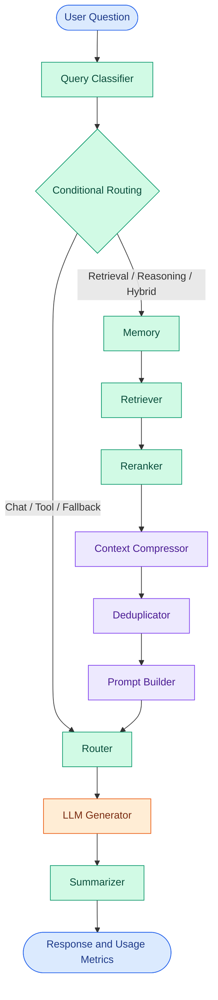

# Token Cost Agent

<p align="center">
  <strong>Context Engineering for More Efficient LLM Workflows</strong>
  <br>
  A modular, stateful AI workflow for retrieval, context optimization, and token-usage analysis.
</p>

<p align="center">
  <a href="https://github.com/maahii-in/token-cost-cutting">
    
  </a>
  <a href="https://github.com/maahii-in/token-cost-cutting">
    
  </a>
  <a href="https://groq.com/">
    
  </a>
  <a href="https://github.com/maahii-in/token-cost-cutting/stargazers">
    
  </a>
</p>

<p align="center">
  <a href="#-overview">Overview</a> ·
  <a href="#-key-capabilities">Capabilities</a> ·
  <a href="#-architecture">Architecture</a> ·
  <a href="#-getting-started">Getting Started</a> ·
  <a href="#-evaluation">Evaluation</a> ·
  <a href="#-contributing">Contributing</a>
</p>

---

## Table of Contents

- [Overview](#-overview)
- [Problem Statement](#-problem-statement)
- [Key Capabilities](#-key-capabilities)
- [Technology Stack](#-technology-stack)
- [Architecture](#-architecture)
- [Project Structure](#-project-structure)
- [Getting Started](#-getting-started)
- [Configuration](#-configuration)
- [Usage](#-usage)
- [Testing](#-testing)
- [Evaluation](#-evaluation)
- [Troubleshooting](#-troubleshooting)
- [Roadmap](#-roadmap)
- [Contributing](#-contributing)
- [Security](#-security)
- [Author](#-author)

## 🎯 Overview

**Token Cost Agent** is a Python application that explores token-aware processing in large language model (LLM) workflows.

Built with **LangGraph**, it connects specialized processing nodes for query classification, memory, retrieval, reranking, context compression, deduplication, prompt construction, response generation, and summarization.

The project provides a modular foundation for exploring how context selection and prompt processing influence token consumption, answer quality, and execution efficiency.

### Design principles

- **Modularity:** Each workflow stage has a dedicated responsibility.
- **Context relevance:** Retrieve and prioritize information appropriate to the query.
- **Token awareness:** Capture available usage metrics during execution.
- **Configurability:** Centralize model, database, retrieval, and runtime settings.
- **Measurability:** Evaluate optimization against a baseline rather than assuming savings.

> **Project status:** Under active development. Performance improvements and cost savings are not guaranteed and should be validated experimentally.

## 💡 Problem Statement

LLM applications may consume unnecessary input tokens when prompts contain repetitive information, irrelevant documents, or oversized context.

This can increase request costs and processing time, depending on the model and provider.

Token Cost Agent explores a modular processing pipeline to investigate these challenges.

| Challenge | Processing approach |
|---|---|
| Different types of questions | Query classification and conditional routing |
| Irrelevant retrieved content | Retrieval and document reranking |
| Excessive prompt context | Context compression |
| Repeated information | Deduplication |
| Complex application logic | Stateful LangGraph orchestration |
| Limited usage visibility | Token-usage metrics |

The goal is to investigate these techniques while preserving answer relevance and usefulness.

## ✨ Key Capabilities

### Query classification and routing

Categorizes user questions and directs them to the appropriate workflow path.

### Retrieval pipeline

Processes retrieval-oriented questions through memory, document retrieval, and subsequent context refinement.

### Context refinement

Includes reranking, compression, and deduplication components to process retrieved information before prompt construction.

### LLM response generation

Integrates with Groq using a configurable language model.

### Token-usage reporting

Displays the metrics recorded in the shared workflow state, organized by node.

### Centralized configuration

Uses Pydantic Settings to manage provider credentials, database connections, retrieval limits, model selection, logging, and other application settings.

### Modular application state

Defines structured document and agent-state models using Pydantic, providing a shared representation of the question, query type, retrieved documents, prompt, response, and usage metrics.

## 🧰 Technology Stack

| Technology | Responsibility |
|---|---|
| Python | Core application language |
| LangGraph | Workflow orchestration and conditional routing |
| LangChain | LLM application components |
| Groq | Language model provider |
| PostgreSQL | Relational database integration |
| Milvus | Vector database integration |
| Redis | Cache integration |
| Sentence Transformers | Embedding and reranking model support |
| `tiktoken` | Token-counting utilities |
| Pydantic Settings | Validated configuration |
| pytest | Automated testing |

### Model configuration

The current application configuration specifies these defaults:

| Component | Configured model |
|---|---|
| Language model | `llama-3.3-70b-versatile` |
| Embedding model | `BAAI/bge-small-en-v1.5` |
| Reranking model | `BAAI/bge-reranker-base` |

These values can be adjusted through the settings system. Check provider compatibility and model availability before changing them.

## 🏗️ Architecture

The application uses LangGraph's `StateGraph` to coordinate nodes around a shared `AgentState`.



### Execution lifecycle

| Stage | Responsibility |
|---|---|
| 1. Classification | Categorizes the incoming question |
| 2. Routing | Selects the chat/tool/fallback or retrieval-oriented path |
| 3. Retrieval | Retrieves relevant information for the selected retrieval path |
| 4. Reranking | Reorders retrieved documents |
| 5. Compression | Processes context before prompt construction |
| 6. Deduplication | Handles repeated context |
| 7. Prompt construction | Builds the prompt from the available information |
| 8. Generation | Invokes the configured LLM node |
| 9. Summarization | Processes the generated response |
| 10. Reporting | Displays available token-usage metrics |

The diagram follows the routing and edges defined in [`graph.py`](graph.py). Individual node behavior is implemented in the `nodes/` package.

### State management

The shared `AgentState` model contains fields for:

- User question and query classification.
- Stored memories.
- Retrieved, reranked, and compressed documents.
- Constructed prompt and generated response.
- Per-node token-usage metrics.
- Additional metadata.

This shared state allows the workflow's nodes to exchange structured information.

## 📁 Project Structure

```text
token-cost-cutting/
│
├── common/                 # Shared utilities and components
├── db/                     # Database integrations
├── nodes/                  # Specialized workflow nodes
├── prompts/                # Prompt templates
├── tests/                  # Test-related modules
│
├── app.py                  # Interactive CLI entry point
├── config.py               # Centralized application settings
├── graph.py                # LangGraph workflow definition
├── state.py                # Shared document and agent state
│
├── test_db.py              # Database test module
├── test_milvus.py          # Milvus test module
├── requirements.txt        # Python dependencies
└── .gitignore              # Git exclusions
```

## 🚀 Getting Started

### Prerequisites

Before running the project, prepare:

- Python and pip.
- Git.
- A valid Groq API key.
- PostgreSQL credentials.
- Any additional services required by the workflow nodes you plan to execute.

Milvus and Redis may require separate service setup. Database initialization and service availability depend on your local environment.

### 1. Clone the repository

```bash
git clone https://github.com/maahii-in/token-cost-cutting.git
cd token-cost-cutting
```

### 2. Create a virtual environment

**Windows PowerShell**

```powershell
python -m venv .venv
.\.venv\Scripts\Activate.ps1
```

**macOS / Linux**

```bash
python3 -m venv .venv
source .venv/bin/activate
```

### 3. Install dependencies

```bash
python -m pip install --upgrade pip
pip install -r requirements.txt
```

The project includes machine-learning packages that may download model files on first use. Installation time and resource requirements vary by environment.

### 4. Configure environment variables

Create a `.env` file in the repository root.

```dotenv
# Application
APP_NAME=Token Cost Agent
APP_ENV=development
APP_DEBUG=true

# Language model provider
GROQ_API_KEY=your_groq_api_key
GROQ_MODEL=llama-3.3-70b-versatile

# PostgreSQL
POSTGRES_HOST=localhost
POSTGRES_PORT=5432
POSTGRES_DB=token_cost_agent
POSTGRES_USER=postgres
POSTGRES_PASSWORD=your_database_password

# Milvus
MILVUS_HOST=localhost
MILVUS_PORT=19530
MILVUS_COLLECTION=documents

# Redis
REDIS_HOST=localhost
REDIS_PORT=6379
REDIS_DB=0
```

The values above are examples based on `config.py`. Check the configuration file for the complete list of settings and defaults before running the application.

**Security requirement:** Replace the credential placeholders and never commit your `.env` file, API keys, or database passwords to source control.

## ⚙️ Configuration Reference

Application settings are centralized in `config.py` and loaded through Pydantic Settings.

| Setting | Default | Description |
|---|---|---|
| `APP_NAME` | `Token Cost Agent` | Application name |
| `APP_ENV` | `development` | Runtime environment |
| `APP_DEBUG` | `True` | Debug configuration |
| `GROQ_API_KEY` | Required | Groq API credential |
| `GROQ_MODEL` | `llama-3.3-70b-versatile` | LLM model identifier |
| `POSTGRES_HOST` | `localhost` | PostgreSQL server |
| `POSTGRES_PORT` | `5432` | PostgreSQL port |
| `POSTGRES_DB` | `token_cost_agent` | Database name |
| `POSTGRES_USER` | `postgres` | Database username |
| `POSTGRES_PASSWORD` | Required | Database password |
| `MILVUS_HOST` | `localhost` | Milvus host |
| `MILVUS_PORT` | `19530` | Milvus port |
| `MILVUS_COLLECTION` | `documents` | Vector collection |
| `REDIS_HOST` | `localhost` | Redis host |
| `REDIS_PORT` | `6379` | Redis port |
| `REDIS_DB` | `0` | Redis database index |
| `EMBEDDING_MODEL` | `BAAI/bge-small-en-v1.5` | Embedding model |
| `RERANKER_MODEL` | `BAAI/bge-reranker-base` | Reranking model |
| `TOP_K` | `10` | Retrieval result limit |
| `RERANK_TOP_K` | `5` | Reranked result limit |
| `SIMILARITY_THRESHOLD` | `0.75` | Similarity threshold |
| `MAX_DOCUMENT_TOKENS` | `300` | Document token limit |
| `MAX_PROMPT_TOKENS` | `4000` | Prompt token limit |
| `LOG_LEVEL` | `INFO` | Logging level |
| `LOG_FILE` | `logs/agent.log` | Log file path |
| `ENABLE_TOKEN_LOGGING` | `True` | Token logging setting |
| `ENABLE_COST_TRACKING` | `True` | Cost tracking setting |
| `CHECKPOINT_PATH` | `checkpoints/` | Checkpoint path |
| `CACHE_TTL` | `3600` | Cache time-to-live |
| `HOST` | `0.0.0.0` | Configured host |
| `PORT` | `8000` | Configured port |

The application entry point currently runs an interactive CLI. The existence of `HOST` and `PORT` settings does not mean that a web server is started.

For the complete configuration, refer to [`config.py`](config.py).

## 💻 Usage

Start the application from the repository root:

```bash
python app.py
```

The application opens an interactive terminal session.

Example:

```text
============================================================
        TOKEN COST AGENT
============================================================

Question > How can I reduce unnecessary context in an LLM prompt?
```

After processing, the application prints the generated answer and the available token-usage information recorded by workflow nodes.

To exit, enter:

```text
exit
```

You can also enter `quit` or `q`, or press `Ctrl+C`.

The response and usage metrics depend on the successful execution of the configured nodes and external services.

## 🧪 Testing

Run the available test suite:

```bash
pytest
```

Run the individual database test modules:

```bash
pytest -v test_db.py
pytest -v test_milvus.py
```

For more detailed test output:

```bash
pytest -vv
```

Some tests may require running services, valid credentials, and initialized test data.

The presence of test modules should not be interpreted as a particular test coverage percentage; coverage must be measured separately.

## 📊 Evaluation

A token-efficiency project should demonstrate improvements with reproducible measurements.

### Recommended evaluation metrics

| Metric | Measurement goal |
|---|---|
| Input tokens | Count the tokens provided to the model |
| Output tokens | Count the generated response tokens |
| Context tokens before processing | Establish the baseline input context |
| Context tokens after processing | Measure the effect of context refinement |
| Estimated request cost | Calculate cost using the applicable model pricing |
| Response quality | Assess relevance, completeness, and usefulness |
| End-to-end latency | Measure the total execution time |

### Suggested benchmark procedure

1. Prepare a representative dataset of questions and source documents.
2. Run a baseline workflow without the optimization under evaluation.
3. Run the corresponding optimized workflow on the same inputs.
4. Record actual token usage and response quality where available.
5. Compare cost estimates and latency under equivalent conditions.
6. Document the model, dataset, configuration, and methodology.

The percentage of token reduction can be calculated as:

\[
\text{Reduction (\%)} =
\frac{\text{Baseline Tokens} - \text{Optimized Tokens}}
{\text{Baseline Tokens}} \times 100
\]

This calculation is valid only when measurements use comparable inputs and counting methods.

**No benchmark results or savings percentages are claimed here.** They should be added after running and documenting actual experiments.

## 🛠️ Troubleshooting

| Issue | Checks |
|---|---|
| Missing API credentials | Verify `GROQ_API_KEY` and the `.env` file |
| Configuration validation fails | Compare required fields with `config.py` |
| PostgreSQL connection error | Verify the service, database, host, port, and credentials |
| Milvus connection error | Check service availability and collection initialization |
| Redis connection error | Confirm the Redis service and connection settings |
| Model initialization fails | Check dependencies, network access, and model availability |
| Test failures | Inspect the traceback and verify service prerequisites |
| Unexpected query routing | Review the classifier and routing function in `graph.py` |

## 🗺️ Roadmap

Potential future improvements:

- [ ] Establish reproducible token-efficiency benchmarks.
- [ ] Compare baseline and optimized workflows.
- [ ] Improve token usage and model-cost reporting.
- [ ] Evaluate
