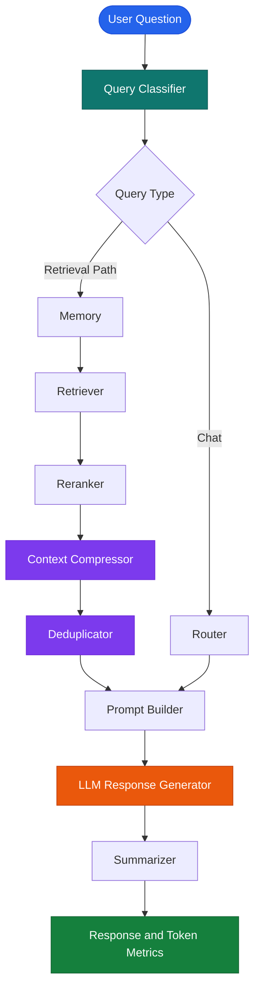

# ⚡ Token Cost Cutting

<p align="center">
  
</p>

<p align="center">
  <strong>An LLM-powered agent designed to make AI workflows more token-efficient through context retrieval, compression, deduplication, and token usage tracking.</strong>
</p>

<p align="center">
  <a href="https://github.com/maahii-in/token-cost-cutting">
    
  </a>
  
  
  
  
</p>

<p align="center">
  <a href="#-overview">Overview</a> •
  <a href="#-features">Features</a> •
  <a href="#-architecture">Architecture</a> •
  <a href="#-installation">Installation</a> •
  <a href="#-usage">Usage</a> •
  <a href="#-testing">Testing</a>
</p>

---

## 🧭 Overview

Large language model applications can spend unnecessary tokens processing repeated context, irrelevant information, and oversized prompts.

**Token Cost Cutting** is a Python-based AI agent project that explores ways to make LLM workflows more efficient. It uses a LangGraph-based pipeline with specialized processing nodes for query classification, memory, retrieval, reranking, context compression, deduplication, prompt construction, response generation, and summarization.

The application also tracks token usage metrics exposed by its workflow, helping you inspect processing costs across individual stages.

### 💡 The core idea

> Retrieve what matters. Remove unnecessary context. Build a leaner prompt. Track token usage.

## ✨ Features

<table>
  <tr>
    <td width="50%">
      <h3>🧠 Intelligent Query Processing</h3>
      Classifies incoming questions and routes them through the appropriate workflow.
    </td>
    <td width="50%">
      <h3>🔎 Context Retrieval</h3>
      Uses retrieval components to identify potentially relevant information for a query.
    </td>
  </tr>
  <tr>
    <td width="50%">
      <h3>🎯 Reranking</h3>
      Reorders retrieved documents to prioritize context that may be more relevant.
    </td>
    <td width="50%">
      <h3>📦 Context Compression</h3>
      Includes a compression stage intended to reduce unnecessary prompt context.
    </td>
  </tr>
  <tr>
    <td width="50%">
      <h3>♻️ Deduplication</h3>
      Includes a dedicated stage for handling duplicate context.
    </td>
    <td width="50%">
      <h3>📊 Token Usage Metrics</h3>
      Displays available token metrics by workflow node after a response is generated.
    </td>
  </tr>
  <tr>
    <td width="50%">
      <h3>⚡ LLM Integration</h3>
      Configures Groq with the <code>llama-3.3-70b-versatile</code> model as the default.
    </td>
    <td width="50%">
      <h3>🧪 Test Support</h3>
      Includes database and Milvus test modules, along with pytest as a development dependency.
    </td>
  </tr>
</table>

> **Note:** These features correspond to components in the current repository. Actual token savings and the behavior of individual stages depend on their implementation, data, and configuration.

## 🏗️ Architecture

The application uses **LangGraph** to connect specialized nodes into a stateful workflow.



*Conceptual overview of the workflow. Exact execution paths are determined by the routing logic in `graph.py`.*

### 🔄 How the workflow works

| Stage | Component | Responsibility |
|---|---|---|
| 01 | Classifier | Determines the query category |
| 02 | Memory | Handles the workflow's memory stage |
| 03 | Retriever | Retrieves relevant documents |
| 04 | Reranker | Reorders retrieved context |
| 05 | Compressor | Processes context for compression |
| 06 | Deduplicator | Handles duplicate context |
| 07 | Prompt Builder | Constructs the prompt |
| 08 | Router | Routes the query through the appropriate path |
| 09 | LLM | Generates the response |
| 10 | Summarizer | Processes the response through a summarization stage |
| 11 | Metrics | Prints available token usage data |

## 🛠️ Technology Stack

<p align="center">
  
</p>

| Technology | Purpose |
|---|---|
| Python | Core programming language |
| LangGraph | Stateful agent workflow orchestration |
| LangChain | LLM application components |
| Groq | LLM provider integration |
| PostgreSQL | Relational database configuration |
| Milvus | Vector database integration |
| Redis | Cache and data-store configuration |
| Sentence Transformers | Embedding and reranking model support |
| `tiktoken` | Token counting utilities |
| Pydantic Settings | Configuration and environment variable management |
| pytest | Testing framework |

### 🤖 Default model configuration

| Setting | Default |
|---|---|
| LLM provider | Groq |
| LLM model | `llama-3.3-70b-versatile` |
| Embedding model | `BAAI/bge-small-en-v1.5` |
| Reranker model | `BAAI/bge-reranker-base` |
| PostgreSQL database | `token_cost_agent` |
| Milvus collection | `documents` |

These values come from the current project configuration and may be changed to suit your environment.

## 📂 Project Structure

```text
token-cost-cutting/
│
├── common/              # Shared utilities and common components
├── db/                  # Database-related modules
├── nodes/               # Specialized agent workflow nodes
├── prompts/             # Prompt templates and instructions
├── tests/               # Project test suite
│
├── app.py               # Application entry point
├── config.py            # Centralized application configuration
├── graph.py             # LangGraph workflow definition
├── state.py             # Shared agent state and token metrics
│
├── test_db.py           # Database tests
├── test_milvus.py       # Milvus-related tests
├── requirements.txt     # Python dependencies
├── .gitignore           # Git exclusions
└── README.md            # Project documentation
```

## 🚀 Installation

Follow these steps to set up the project locally.

### 1. Prerequisites

Make sure you have:

- Python installed.
- Git installed.
- A Groq API key.
- PostgreSQL, Milvus, and Redis services configured if required by the workflow components you intend to run.

### 2. Clone the repository

```bash
git clone https://github.com/maahii-in/token-cost-cutting.git
cd token-cost-cutting
```

### 3. Create a virtual environment

**Windows — PowerShell**

```powershell
python -m venv .venv
.\.venv\Scripts\Activate.ps1
```

**macOS / Linux**

```bash
python3 -m venv .venv
source .venv/bin/activate
```

### 4. Install dependencies

```bash
python -m pip install --upgrade pip
pip install -r requirements.txt
```

Some dependencies, especially machine-learning packages, may require additional system libraries or a compatible Python environment.

### 5. Configure environment variables

Create a `.env` file in the project root.

```env
# LLM provider
GROQ_API_KEY=your_groq_api_key
GROQ_MODEL=llama-3.3-70b-versatile

# PostgreSQL
POSTGRES_HOST=localhost
POSTGRES_PORT=5432
POSTGRES_DB=token_cost_agent
POSTGRES_USER=postgres
POSTGRES_PASSWORD=your_postgres_password

# Milvus
MILVUS_HOST=localhost
MILVUS_PORT=19530
MILVUS_COLLECTION=documents

# Redis
REDIS_HOST=localhost
REDIS_PORT=6379
REDIS_DB=0

# Embedding and reranking
EMBEDDING_MODEL=BAAI/bge-small-en-v1.5
RERANKER_MODEL=BAAI/bge-reranker-base

# Application
APP_ENV=development
APP_DEBUG=true
```

The values above reflect the project's declared settings and defaults. Review `config.py` for other configuration options required by your local setup.

**Security:** Never commit your `.env` file or expose API keys, database passwords, or other credentials in screenshots or logs.

## ▶️ Usage

The current entry point, `app.py`, runs an interactive terminal application.

Start it from the repository root:

```bash
python app.py
```

When initialization succeeds, the application displays a banner and prompts you for a question.

```text
============================================================
 TOKEN COST AGENT
============================================================

Question > How can I reduce unnecessary LLM prompt tokens?

============================================================
ANSWER
============================================================

[Generated response]

============================================================
TOKEN USAGE
============================================================

[Workflow node]
[Available metrics]
```

The response and metric values depend on your configuration and actual execution; the output above illustrates the format rather than guaranteed results.

### Exit the application

Enter any of the following commands:

```text
exit
quit
q
```

Press `Ctrl+C` to interrupt execution.

## ⚙️ Configuration

Application settings are centralized in `config.py` and loaded using Pydantic Settings.

| Variable | Purpose | Default |
|---|---|---|
| `GROQ_API_KEY` | Groq authentication | Required |
| `GROQ_MODEL` | Model selection | `llama-3.3-70b-versatile` |
| `POSTGRES_HOST` | PostgreSQL host | `localhost` |
| `POSTGRES_PORT` | PostgreSQL port | `5432` |
| `POSTGRES_DB` | PostgreSQL database | `token_cost_agent` |
| `POSTGRES_USER` | PostgreSQL user | `postgres` |
| `POSTGRES_PASSWORD` | PostgreSQL password | Required |
| `MILVUS_HOST` | Milvus host | `localhost` |
| `MILVUS_PORT` | Milvus port | `19530` |
| `REDIS_HOST` | Redis host | `localhost` |
| `REDIS_PORT` | Redis port | `6379` |
| `REDIS_DB` | Redis database index | `0` |
| `EMBEDDING_MODEL` | Embedding model | `BAAI/bge-small-en-v1.5` |
| `RERANKER_MODEL` | Reranker model | `BAAI/bge-reranker-base` |

Not every service necessarily needs to be running for every execution path. Check the relevant node and database implementations to determine which services are required.

## 🧪 Testing

The repository includes test modules for database and Milvus functionality.

Run the test suite from the root directory:

```bash
pytest
```

To run individual modules:

```bash
pytest test_db.py
pytest test_milvus.py
```

Database-related tests may require running services, valid connection settings, and initialized test data.

For a more detailed test report:

```bash
pytest -v
```

## 📊 Token Efficiency

The project is designed to explore token-aware processing through several stages:

- **Retrieval:** Bring potentially relevant context into the workflow.
- **Reranking:** Prioritize more relevant retrieved documents.
- **Compression:** Process context before it is added to the prompt.
- **Deduplication:** Handle repeated context.
- **Token metrics:** Inspect the usage information exposed by the pipeline.

These techniques can help reduce unnecessary context, but they do not guarantee a particular percentage of savings. Actual token usage depends on the model, prompt, source material, and implementation of each stage.

## 🗺️ Roadmap

The following are possible development goals, not claims that the features are already implemented.

- [ ] Add before-and-after token usage comparisons.
- [ ] Report estimated API cost alongside token counts.
- [ ] Benchmark prompt compression against an uncompressed baseline.
- [ ] Expand automated tests for workflow nodes.
- [ ] Improve configuration validation and startup diagnostics.
- [ ] Add structured logging and exportable usage reports.
- [ ] Document supported database setup and initialization procedures.
- [ ] Add reproducible evaluation cases for answer quality and token efficiency.

## 🤝 Contributing

Contributions, suggestions, and bug reports are welcome.

1. Fork the repository.
2. Create a feature branch.
3. Make your changes and add relevant tests.
4. Run the available test suite.
5. Open a pull request describing your changes.

```bash
git checkout -b feature/your-feature
git add .
git commit -m "feat: describe your change"
git push origin feature/your-feature
```

## 🔐 Security

- Keep credentials in environment variables.
- Never commit API keys or production database passwords.
- Avoid placing sensitive user data in debugging output.
- Use dedicated development credentials and databases when testing.
- Review database access and network exposure before deploying.

If you discover a security issue, please avoid publishing credentials or exploit details in a public issue.

## 👨‍💻 Developer

<p align="center">
  <strong>MAHI BUDATI</strong>
  <br/>
  Python Developer · AI Engineering · LLM Applications
  <br/><br/>
  <a href="https://github.com/maahii-in">
    
  </a>
  <a href="https://github.com/maahii-in/token-cost-cutting">
    
  </a>
</p>

I’m exploring practical ways to build more efficient LLM applications by combining retrieval, prompt processing, workflow orchestration, and token usage analysis.

## ⭐ Support

If you find this project useful, consider giving the repository a star.

<p align="center">
  <a href="https://github.com/maahii-in/token-cost-cutting/stargazers">
    
  </a>
</p>

---

<p align="center">
  <a href="#-token-cost-cutting">⬆️ Back to top</a>
  <br/><br/>
  <sub>Built with Python and LangGraph · Focused on more efficient AI workflows</sub>
</p>

<p align="center">
  
</p>
