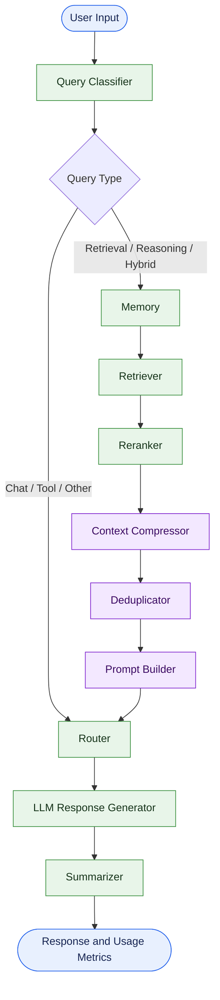

# Token Cost Agent

<p align="center">
  <strong>A modular, token-aware LLM workflow for context optimization and efficient response generation.</strong>
</p>

<p align="center">
  <a href="https://github.com/maahii-in/token-cost-cutting">
    
  </a>
  <a href="https://github.com/maahii-in/token-cost-cutting">
    
  </a>
  <a href="https://groq.com/">
    
  </a>
  <a href="https://github.com/maahii-in/token-cost-cutting/stargazers">
    
  </a>
  <a href="https://github.com/maahii-in/token-cost-cutting/network/members">
    
  </a>
</p>

<p align="center">
  <a href="#overview">Overview</a> ·
  <a href="#capabilities">Capabilities</a> ·
  <a href="#architecture">Architecture</a> ·
  <a href="#getting-started">Getting Started</a> ·
  <a href="#configuration">Configuration</a> ·
  <a href="#testing">Testing</a>
</p>

---

## Overview

**Token Cost Agent** is a Python-based project that explores token-efficient processing in large language model (LLM) applications.

Built around a stateful [LangGraph](https://langchain-ai.github.io/langgraph/) workflow, the application organizes query classification, retrieval, reranking, context compression, deduplication, prompt construction, response generation, and summarization into specialized processing nodes.

The project is designed to make LLM workflows easier to understand, extend, and evaluate, while providing visibility into token-usage metrics.

### Objectives

- Reduce unnecessary context in LLM prompts.
- Organize retrieval and response generation into modular components.
- Track token-usage information throughout the workflow.
- Integrate language models with retrieval and data services.
- Establish a foundation for measuring token efficiency against a baseline.

> **Project status:** In development. Actual token savings, cost reductions, and response quality should be established through reproducible evaluation.

## Capabilities

| Component | Purpose |
|---|---|
| Query classification | Categorizes incoming questions for workflow routing. |
| Memory processing | Handles the memory stage of retrieval-oriented requests. |
| Context retrieval | Retrieves documents for supported query types. |
| Document reranking | Reorders retrieved documents by relevance. |
| Context compression | Processes documents before prompt construction. |
| Deduplication | Handles repeated information in the context pipeline. |
| Prompt construction | Prepares context and instructions for response generation. |
| LLM response generation | Generates responses through the configured Groq integration. |
| Summarization | Processes generated responses through a dedicated node. |
| Token-usage reporting | Displays metrics recorded in the shared workflow state. |

The extent of each capability depends on the corresponding node implementation and service configuration.

## Architecture

The application uses **LangGraph** to define a stateful workflow with conditional routing.



### Workflow stages

1. **Classification:** Categorize the question and select a route.
2. **Retrieval:** For retrieval-oriented routes, collect relevant context.
3. **Refinement:** Rerank, compress, and deduplicate retrieved documents.
4. **Prompt construction:** Prepare the prompt for the response generator.
5. **Generation:** Generate a response using the configured language model.
6. **Summarization:** Process the response through the summarization node.
7. **Reporting:** Display available metrics stored in the workflow state.

The diagram reflects the routing and edges defined in `graph.py`. It is a logical workflow representation, not a performance benchmark.

## Technology Stack

| Technology | Role |
|---|---|
| Python | Core application language |
| LangGraph | Workflow orchestration and shared state transitions |
| LangChain | LLM application framework |
| Groq | Language-model provider |
| PostgreSQL | Relational database integration |
| Milvus | Vector database integration |
| Redis | Cache integration |
| Sentence Transformers | Embedding and reranking model support |
| `tiktoken` | Token-counting utilities |
| Pydantic Settings | Type-validated application configuration |
| pytest | Automated testing |

### Model configuration

The current configuration specifies the following default models:

| Model component | Configured model |
|---|---|
| Language model | `llama-3.3-70b-versatile` |
| Embeddings | `BAAI/bge-small-en-v1.5` |
| Reranking | `BAAI/bge-reranker-base` |

These values are configurable. Availability and compatibility depend on the corresponding provider, installed dependencies, and runtime environment.

## Project Structure

```text
token-cost-cutting/
├── common/                 # Shared utilities
├── db/                     # Database integration
├── nodes/                  # Agent workflow nodes
├── prompts/                # Prompt templates
├── tests/                  # Test-related modules
│
├── app.py                  # Interactive application entry point
├── config.py               # Application settings
├── graph.py                # LangGraph workflow definition
├── state.py                # Shared agent state and metrics
├── test_db.py              # Database tests
├── test_milvus.py          # Milvus tests
├── requirements.txt        # Python dependencies
└── .gitignore              # Git exclusions
```

## Getting Started

### Prerequisites

Install the following before starting:

- Python
- Git
- A Groq API key
- The configured database and supporting services required by the execution path

PostgreSQL, Milvus, and Redis may require separate installation or service configuration.

### 1. Clone the repository

```bash
git clone https://github.com/maahii-in/token-cost-cutting.git
cd token-cost-cutting
```

### 2. Create a virtual environment

**Windows — PowerShell**

```powershell
python -m venv .venv
.\.venv\Scripts\Activate.ps1
```

**macOS / Linux**

```bash
python3 -m venv .venv
source .venv/bin/activate
```

### 3. Install dependencies

```bash
python -m pip install --upgrade pip
pip install -r requirements.txt
```

### 4. Configure environment variables

Create a `.env` file in the repository root:

```dotenv
# Language model
GROQ_API_KEY=your_groq_api_key
GROQ_MODEL=llama-3.3-70b-versatile

# PostgreSQL
POSTGRES_HOST=localhost
POSTGRES_PORT=5432
POSTGRES_DB=token_cost_agent
POSTGRES_USER=postgres
POSTGRES_PASSWORD=your_database_password

# Milvus
MILVUS_HOST=localhost
MILVUS_PORT=19530
MILVUS_COLLECTION=documents

# Redis
REDIS_HOST=localhost
REDIS_PORT=6379
REDIS_DB=0
```

The configuration also defines embedding, reranking, retrieval, compression, logging, caching, and application settings. Refer to [`config.py`](config.py) for the full list of available options and defaults.

The example above contains placeholders, not working credentials. Replace them with your actual configuration before running the application.

### 5. Run the application

```bash
python app.py
```

The application starts an interactive terminal session and prompts for a question.

Example:

```text
============================================================
        TOKEN COST AGENT
============================================================

Question > How can I reduce unnecessary context in an LLM prompt?

============================================================
ANSWER
============================================================

[Generated response]

============================================================
TOKEN USAGE
============================================================

[Available metrics]
```

The output above illustrates the interaction format. The actual response and metrics depend on successful initialization and execution of the configured workflow.

To exit, enter `exit`, `quit`, or `q`.

## Configuration

Application settings are centralized in `config.py` and loaded from environment variables, including a `.env` file.

| Setting | Default | Description |
|---|---|---|
| `APP_NAME` | `Token Cost Agent` | Application name |
| `APP_ENV` | `development` | Runtime environment |
| `APP_DEBUG` | `True` | Development debug setting |
| `GROQ_MODEL` | `llama-3.3-70b-versatile` | LLM model identifier |
| `POSTGRES_HOST` | `localhost` | PostgreSQL server |
| `POSTGRES_PORT` | `5432` | PostgreSQL port |
| `POSTGRES_DB` | `token_cost_agent` | Database name |
| `MILVUS_HOST` | `localhost` | Milvus server |
| `MILVUS_PORT` | `19530` | Milvus port |
| `MILVUS_COLLECTION` | `documents` | Vector collection |
| `REDIS_HOST` | `localhost` | Redis server |
| `REDIS_PORT` | `6379` | Redis port |
| `REDIS_DB` | `0` | Redis database index |
| `EMBEDDING_MODEL` | `BAAI/bge-small-en-v1.5` | Embedding model |
| `RERANKER_MODEL` | `BAAI/bge-reranker-base` | Reranker model |
| `TOP_K` | `10` | Retrieval result limit |
| `RERANK_TOP_K` | `5` | Reranked result limit |
| `SIMILARITY_THRESHOLD` | `0.75` | Similarity threshold |
| `MAX_DOCUMENT_TOKENS` | `300` | Document token limit |
| `MAX_PROMPT_TOKENS` | `4000` | Prompt token limit |
| `ENABLE_TOKEN_LOGGING` | `True` | Token logging flag |
| `ENABLE_COST_TRACKING` | `True` | Cost tracking flag |

`GROQ_API_KEY` and `POSTGRES_PASSWORD` are required by the current settings definition. Other settings may be optional where defaults are provided.

## Testing

Run the available tests from the repository root:

```bash
pytest
```

Run individual test modules:

```bash
pytest -v test_db.py
pytest -v test_milvus.py
```

Database-related tests may require reachable services, valid credentials, and initialized test data. Test coverage and results depend on the current test implementation.

## Evaluating Token Efficiency

The project's context-processing stages provide a foundation for measuring the relationship between prompt size, token usage, and response quality.

A useful evaluation should record:

| Metric | Purpose |
|---|---|
| Input tokens | Measure prompt size |
| Output tokens | Measure generated response size |
| Estimated request cost | Apply the relevant model's pricing to recorded usage |
| Context size before processing | Establish the baseline |
| Context size after processing | Measure the effect of context processing |
| Response quality | Check that optimization preserves answer usefulness |
| Latency | Measure processing time |

For a fair comparison, use the same inputs and model settings for both the baseline and optimized workflow. Do not claim a percentage reduction until it has been measured and documented.

## Roadmap

Potential next steps for the project include:

- [ ] Add baseline-versus-optimized token comparisons.
- [ ] Validate cost estimates against model-specific pricing.
- [ ] Create reproducible context-compression benchmarks.
- [ ] Measure latency and response quality alongside token use.
- [ ] Expand unit and integration tests for workflow nodes.
- [ ] Improve structured logging and error handling.
- [ ] Document database initialization and deployment.
- [ ] Add exportable usage reports.

These are proposed improvements, not a representation of completed features.

## Contributing

Contributions, bug reports, and suggestions are welcome.

1. Fork the repository.
2. Create a branch for your change.
3. Implement the change and add tests where appropriate.
4. Run the relevant tests.
5. Submit a pull request with a clear description.

```bash
git checkout -b feature/your-change
git add .
git commit -m "Describe your change"
git push origin feature/your-change
```

## Security

- Keep credentials and API keys out of source control.
- Store secrets in environment variables or a suitable secrets manager.
- Use dedicated development credentials for testing.
- Avoid logging sensitive prompts or retrieved content.
- Restrict database and cache access to trusted services.
- Keep dependencies updated and review security advisories.

## Maintainer

**Mahi Budati**

[GitHub Profile](https://github.com/maahii-in) · [Repository](https://github.com/maahii-in/token-cost-cutting)

---

<p align="center">
  <a href="#token-cost-agent">Back to top ↑</a>
</p>
