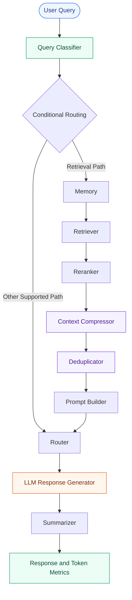

# Token Cost Agent

<p align="center">
  <strong>Engineering more efficient LLM workflows through intelligent context processing and token-aware execution.</strong>
</p>

<p align="center">
  A modular Python application exploring context optimization, retrieval pipelines, and token usage analysis with LangGraph.
</p>

<p align="center">
  <a href="https://github.com/maahii-in/token-cost-cutting">
    
  </a>
  <a href="https://github.com/maahii-in/token-cost-cutting/stargazers">
    
  </a>
  <a href="https://github.com/maahii-in/token-cost-cutting/network/members">
    
  </a>
  <a href="https://github.com/maahii-in/token-cost-cutting/issues">
    
  </a>
  <a href="https://github.com/maahii-in/token-cost-cutting/commits/main">
    
  </a>
</p>

<p align="center">
  <a href="#overview">Overview</a> ·
  <a href="#key-capabilities">Capabilities</a> ·
  <a href="#system-architecture">Architecture</a> ·
  <a href="#getting-started">Getting Started</a> ·
  <a href="#testing">Testing</a> ·
  <a href="#roadmap">Roadmap</a>
</p>

---

## Table of Contents

- [Overview](#overview)
- [Problem Statement](#problem-statement)
- [Key Capabilities](#key-capabilities)
- [Technology Stack](#technology-stack)
- [System Architecture](#system-architecture)
- [Project Structure](#project-structure)
- [Getting Started](#getting-started)
- [Configuration](#configuration)
- [Running the Application](#running-the-application)
- [Testing](#testing)
- [Token-Efficiency Evaluation](#token-efficiency-evaluation)
- [Troubleshooting](#troubleshooting)
- [Roadmap](#roadmap)
- [Contributing](#contributing)
- [Security](#security)
- [Maintainer](#maintainer)

## Overview

**Token Cost Agent** is a Python-based project that explores ways to improve the efficiency of large language model (LLM) applications.

The application uses **LangGraph** to organize query processing, retrieval, reranking, context compression, deduplication, prompt construction, and response generation into modular workflow components.

The project provides a foundation for investigating how context selection and prompt optimization affect token consumption, response quality, and execution time.

### Project goals

- Minimize unnecessary context passed to language models.
- Organize LLM processing into modular, maintainable components.
- Retrieve and prioritize relevant information.
- Investigate context compression and duplicate removal.
- Track available token-usage metrics throughout execution.
- Establish reproducible methods for evaluating optimization strategies.

> **Project status:** Under development. Token savings and cost reductions must be validated through measured results.

## Problem Statement

LLM applications can process more input tokens than necessary when prompts contain repetitive information, irrelevant documents, or excessive context.

This can increase processing costs and latency, depending on the model and service being used.

Token Cost Agent explores a modular approach to this problem:

| Challenge | Approach |
|---|---|
| Irrelevant context | Retrieve information relevant to the query |
| Poor document ordering | Apply a reranking stage |
| Oversized prompts | Process context through a compression stage |
| Repeated information | Apply deduplication |
| Limited usage visibility | Track available token metrics |
| Difficult optimization comparisons | Establish baseline and optimized evaluations |

These approaches are intended to reduce unnecessary processing while preserving the relevance and usefulness of generated responses.

## Key Capabilities

### 1. Query Processing

Classifies incoming questions and supports conditional routing through the workflow.

### 2. Context Retrieval

Provides a retrieval stage for collecting potentially relevant information for supported query types.

### 3. Document Reranking

Reorders retrieved documents to prioritize relevant context before prompt construction.

### 4. Context Compression

Includes a dedicated component for processing context before it reaches the language model.

### 5. Deduplication

Includes a stage for handling repeated context and reducing unnecessary duplication.

### 6. LLM Integration

Uses a configurable Groq integration for response generation.

### 7. Token Usage Reporting

Displays token-related metrics available in the shared workflow state.

### 8. Modular Architecture

Separates workflow orchestration, configuration, state management, prompts, shared utilities, and node implementations.

*The capabilities listed above describe the project's components. Actual effectiveness depends on their implementation, configuration, and runtime behavior.*

## Technology Stack

| Technology | Role |
|---|---|
| Python | Core application language |
| LangGraph | Stateful workflow orchestration |
| LangChain | LLM application components |
| Groq | Language-model provider |
| PostgreSQL | Relational database integration |
| Milvus | Vector database integration |
| Redis | Cache integration |
| Sentence Transformers | Embedding and reranking model support |
| `tiktoken` | Token-counting utilities |
| Pydantic Settings | Configuration management |
| pytest | Testing framework |

### Configured models

The project configuration specifies the following model defaults:

| Component | Model |
|---|---|
| Language model | `llama-3.3-70b-versatile` |
| Embedding model | `BAAI/bge-small-en-v1.5` |
| Reranking model | `BAAI/bge-reranker-base` |

Model availability, provider compatibility, and hardware requirements should be verified for your environment.

## System Architecture

The project uses **LangGraph** to coordinate processing nodes and maintain shared state.



*This diagram is a conceptual representation of the workflow. Refer to `graph.py` for the actual nodes, edges, and conditional routing.*

### Execution lifecycle

1. **Receive:** Accept a question from the user.
2. **Classify:** Determine the query category.
3. **Retrieve:** Collect relevant context when required by the selected route.
4. **Refine:** Process the retrieved context through reranking, compression, and deduplication.
5. **Construct:** Build the prompt for the language model.
6. **Generate:** Produce a response using the configured LLM.
7. **Summarize:** Process the response through the summarization stage.
8. **Report:** Display the available usage metrics.

## Project Structure

```text
token-cost-cutting/
│
├── common/                 # Shared utilities and components
├── db/                     # Database integrations
├── nodes/                  # Workflow node implementations
├── prompts/                # Prompt templates
├── tests/                  # Test-related files
│
├── app.py                  # Application entry point
├── config.py               # Application configuration
├── graph.py                # LangGraph workflow definition
├── state.py                # Shared workflow state and metrics
│
├── test_db.py              # Database tests
├── test_milvus.py          # Milvus tests
├── requirements.txt        # Python dependencies
└── .gitignore              # Git exclusions
```

## Getting Started

### Prerequisites

Make sure the following are available:

- Python and pip
- Git
- A Groq API key
- The supporting services required by the workflow you plan to run

PostgreSQL, Milvus, and Redis may require separate installation, initialization, and connection configuration.

### Step 1: Clone the repository

```bash
git clone https://github.com/maahii-in/token-cost-cutting.git
cd token-cost-cutting
```

### Step 2: Create a virtual environment

**Windows PowerShell**

```powershell
python -m venv .venv
.\.venv\Scripts\Activate.ps1
```

**macOS / Linux**

```bash
python3 -m venv .venv
source .venv/bin/activate
```

### Step 3: Install dependencies

```bash
python -m pip install --upgrade pip
pip install -r requirements.txt
```

### Step 4: Configure the environment

Create a `.env` file in the repository root and add the values required by `config.py`.

```dotenv
# LLM provider
GROQ_API_KEY=your_groq_api_key
GROQ_MODEL=llama-3.3-70b-versatile

# PostgreSQL
POSTGRES_HOST=localhost
POSTGRES_PORT=5432
POSTGRES_DB=token_cost_agent
POSTGRES_USER=postgres
POSTGRES_PASSWORD=your_database_password

# Milvus
MILVUS_HOST=localhost
MILVUS_PORT=19530
MILVUS_COLLECTION=documents

# Redis
REDIS_HOST=localhost
REDIS_PORT=6379
REDIS_DB=0
```

These are example values based on the project's documented defaults. Confirm the exact variable names and required settings in `config.py` before launching the application.

**Important:** Never commit your `.env` file, API keys, or database credentials to the repository.

## Configuration

Application settings are centralized in `config.py`.

The configuration includes parameters for application behavior, LLM selection, databases, retrieval, reranking, token limits, logging, and cost tracking.

| Setting | Default | Purpose |
|---|---|---|
| `GROQ_MODEL` | `llama-3.3-70b-versatile` | LLM model |
| `POSTGRES_HOST` | `localhost` | PostgreSQL host |
| `POSTGRES_PORT` | `5432` | PostgreSQL port |
| `POSTGRES_DB` | `token_cost_agent` | Database name |
| `MILVUS_HOST` | `localhost` | Milvus host |
| `MILVUS_PORT` | `19530` | Milvus port |
| `MILVUS_COLLECTION` | `documents` | Vector collection |
| `REDIS_HOST` | `localhost` | Redis host |
| `REDIS_PORT` | `6379` | Redis port |
| `REDIS_DB` | `0` | Redis database index |
| `EMBEDDING_MODEL` | `BAAI/bge-small-en-v1.5` | Embedding model |
| `RERANKER_MODEL` | `BAAI/bge-reranker-base` | Reranking model |
| `TOP_K` | `10` | Retrieval result limit |
| `RERANK_TOP_K` | `5` | Reranked result limit |
| `SIMILARITY_THRESHOLD` | `0.75` | Similarity threshold |
| `MAX_DOCUMENT_TOKENS` | `300` | Document token limit |
| `MAX_PROMPT_TOKENS` | `4000` | Prompt token limit |
| `ENABLE_TOKEN_LOGGING` | `True` | Token logging setting |
| `ENABLE_COST_TRACKING` | `True` | Cost tracking setting |

See [`config.py`](config.py) for the authoritative configuration, including any additional settings and defaults.

## Running the Application

Start the interactive application from the repository root:

```bash
python app.py
```

The application is designed to accept a question through the terminal.

Example:

```text
Question > How can I reduce unnecessary context in an LLM prompt?
```

The application processes the question using the configured workflow and displays the generated response and available token-usage metrics.

To exit, enter:

```text
exit
```

The exact output and available execution paths depend on the current implementation and service configuration.

## Testing

Run the available test suite:

```bash
pytest
```

Run the database-related test modules individually:

```bash
pytest -v test_db.py
pytest -v test_milvus.py
```

For a detailed test report:

```bash
pytest -v
```

Tests that depend on external services may require configured credentials, reachable services, and initialized test data.

## Token-Efficiency Evaluation

Token optimization should be demonstrated through measurable results rather than assumed from the presence of compression or deduplication components.

A useful evaluation compares an unoptimized baseline against the optimized workflow using equivalent inputs and model settings.

### Recommended metrics

| Metric | What it measures |
|---|---|
| Input tokens | Tokens sent to the language model |
| Output tokens | Tokens generated by the language model |
| Context size before processing | Initial context size |
| Context size after processing | Context size after optimization |
| Estimated request cost | Cost calculated from applicable model pricing |
| Response quality | Relevance and usefulness of the generated answer |
| Latency | Total response time |

### Evaluation principles

- Use the same dataset and model configuration for both workflows.
- Record actual token usage when provider usage data is available.
- Measure context compression separately from end-to-end token reduction.
- Evaluate response quality alongside token savings.
- Recalculate cost using the applicable model and provider pricing.
- Document the test dataset, methodology, and limitations.

No specific percentage of token or cost reduction is claimed until supported by benchmark results.

## Troubleshooting

| Problem | Recommended action |
|---|---|
| Missing API key | Check that `GROQ_API_KEY` is configured correctly. |
| Database connection failure | Verify the service is running and the connection settings are valid. |
| Milvus connection failure | Confirm the host, port, collection, and service status. |
| Redis connection failure | Verify the Redis host, port, and database index. |
| Dependency installation failure | Check your Python version and package compatibility. |
| Missing environment variables | Compare your `.env` file with `config.py`. |
| Tests fail | Review the traceback and confirm that required services and test data are available. |
| Model initialization failure | Check model availability, installed dependencies, and provider configuration. |

## Roadmap

The following items represent potential future improvements.

- [ ] Add baseline-versus-optimized token comparisons.
- [ ] Add reproducible context-compression benchmarks.
- [ ] Improve API cost estimation and reporting.
- [ ] Measure latency and response quality alongside token usage.
- [ ] Expand unit and integration test coverage.
- [ ] Improve structured logging and error handling.
- [ ] Document database initialization and deployment.
- [ ] Add exportable token-usage reports.

## Contributing

Contributions, suggestions, and bug reports are welcome.

1. Fork the repository.
2. Create a feature branch.
3. Implement your changes and add relevant tests.
4. Run the available test suite.
5. Submit a pull request describing your changes.

```bash
git checkout -b feature/your-change
git add .
git commit -m "Describe your change"
git push origin feature/your-change
```

## Security

- Keep API keys and passwords out of source control.
- Use environment variables or a suitable secrets manager.
- Prefer separate development credentials and test databases.
- Avoid logging sensitive prompts or retrieved documents.
- Restrict access to database and cache services.
- Review dependency updates and security advisories regularly.

## Maintainer

**Mahi Budati**

- GitHub: [@maahii-in](https://github.com/maahii-in)
- Repository: [token-cost-cutting](https://github.com/maahii-in/token-cost-cutting)

---

<p align="center">
  <strong>Token Cost Agent</strong>
  <br>
  <sub>Python · LangGraph · LLM Engineering</sub>
  <br><br>
  <a href="#token-cost-agent">Back to top ↑</a>
</p>
