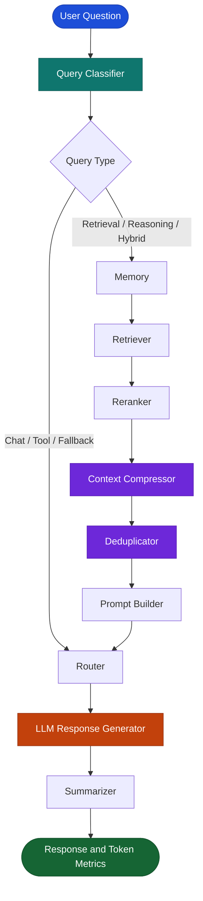

# Token Cost Agent

<p align="center">
  <strong>An intelligent, token-aware LLM workflow for efficient context processing and response generation.</strong>
</p>

<p align="center">
  <a href="https://github.com/maahii-in/token-cost-cutting">
    
  </a>
  <a href="https://github.com/maahii-in/token-cost-cutting">
    
  </a>
  <a href="https://groq.com/">
    
  </a>
  <a href="https://github.com/maahii-in/token-cost-cutting/blob/main/requirements.txt">
    
  </a>
</p>

<p align="center">
  <a href="#overview">Overview</a> ·
  <a href="#features">Features</a> ·
  <a href="#architecture">Architecture</a> ·
  <a href="#installation">Installation</a> ·
  <a href="#usage">Usage</a> ·
  <a href="#testing">Testing</a>
</p>

---

## Overview

Large language model (LLM) applications can consume unnecessary tokens when prompts contain irrelevant, repetitive, or oversized context.

**Token Cost Agent** is a Python-based project that explores token-efficient LLM processing through a modular, stateful workflow built with **LangGraph**.

The workflow organizes query classification, context retrieval, reranking, compression, deduplication, prompt construction, response generation, and token-usage reporting into individual processing stages.

The goal is to make LLM workflows easier to inspect, optimize, and evaluate.

> **Project status:** Under development. Actual token savings and response quality depend on the model, input data, workflow implementation, and evaluation methodology.

## Features

| Capability | Description |
|---|---|
| Query classification | Classifies incoming questions and supports workflow routing. |
| Context retrieval | Retrieves potentially relevant information for context-oriented requests. |
| Reranking | Reorders retrieved documents by relevance. |
| Context compression | Includes a dedicated stage for processing retrieved context. |
| Deduplication | Includes a stage for handling repeated information. |
| Workflow orchestration | Connects processing nodes through LangGraph. |
| LLM integration | Uses Groq as the configured language-model provider. |
| Token usage reporting | Displays token metrics recorded by the workflow. |
| Configurable integrations | Includes configuration for PostgreSQL, Milvus, Redis, embeddings, and reranking. |
| Automated testing | Includes database and Milvus test modules. |

## Architecture

The application organizes processing into a graph of specialized nodes.



### Workflow

1. **Classify:** Determine the incoming query category.
2. **Retrieve:** Identify relevant context when the selected route requires it.
3. **Refine:** Apply reranking, compression, and deduplication stages.
4. **Construct:** Prepare the prompt for the language model.
5. **Generate:** Process the request through the configured LLM.
6. **Summarize:** Pass the response through the summarization stage.
7. **Inspect:** Display available token-usage metrics.

The diagram represents the intended flow based on the project's graph definition. Exact routing and execution depend on the implementation in `graph.py`.

## Technology Stack

| Technology | Purpose |
|---|---|
| Python | Application runtime |
| LangGraph | Stateful workflow orchestration |
| LangChain | LLM application components |
| Groq | Language-model provider |
| PostgreSQL | Relational database integration |
| Milvus | Vector database integration |
| Redis | Cache and data-store integration |
| Sentence Transformers | Embedding and reranking model support |
| `tiktoken` | Token-counting utilities |
| Pydantic Settings | Application configuration |
| pytest | Automated testing |

## Project Structure

```text
token-cost-cutting/
│
├── common/             # Shared utilities and components
├── db/                 # Database integrations
├── nodes/              # Workflow node implementations
├── prompts/            # Prompt templates
├── tests/              # Test suite
│
├── app.py              # Interactive application entry point
├── config.py            # Configuration settings
├── graph.py             # LangGraph workflow definition
├── state.py             # Shared state and usage metrics
│
├── test_db.py           # Database tests
├── test_milvus.py       # Milvus tests
├── requirements.txt     # Python dependencies
└── .gitignore           # Git exclusions
```

## Requirements

Before running the application, make sure you have:

- Python and pip installed.
- Git installed.
- A Groq API key.
- The required database or supporting services configured for your execution path.

Depending on the selected workflow, PostgreSQL, Milvus, Redis, and local machine-learning model dependencies may also be required.

## Installation

### 1. Clone the repository

```bash
git clone https://github.com/maahii-in/token-cost-cutting.git
cd token-cost-cutting
```

### 2. Create a virtual environment

**Windows PowerShell**

```powershell
python -m venv .venv
.\.venv\Scripts\Activate.ps1
```

**macOS / Linux**

```bash
python3 -m venv .venv
source .venv/bin/activate
```

### 3. Install dependencies

```bash
python -m pip install --upgrade pip
pip install -r requirements.txt
```

### 4. Configure environment variables

Create a `.env` file in the project root.

```dotenv
# Groq
GROQ_API_KEY=your_groq_api_key
GROQ_MODEL=llama-3.3-70b-versatile

# PostgreSQL
POSTGRES_HOST=localhost
POSTGRES_PORT=5432
POSTGRES_DB=token_cost_agent
POSTGRES_USER=postgres
POSTGRES_PASSWORD=your_database_password

# Milvus
MILVUS_HOST=localhost
MILVUS_PORT=19530
MILVUS_COLLECTION=documents

# Redis
REDIS_HOST=localhost
REDIS_PORT=6379
REDIS_DB=0

# Embedding and reranking models
EMBEDDING_MODEL=BAAI/bge-small-en-v1.5
RERANKER_MODEL=BAAI/bge-reranker-base
```

These are example settings for the project configuration. Review `config.py` for the authoritative defaults and any additional required variables before running the application.

**Security:** Never commit your `.env` file, API keys, or database credentials to GitHub.

## Usage

Start the interactive application from the repository root:

```bash
python app.py
```

Enter your question when prompted.

Example input:

```text
Question > How can I reduce unnecessary context in an LLM prompt?
```

The application generates a response and displays the token-usage information recorded by the workflow.

The actual output depends on the configured model, available services, and successful execution of the required workflow stages.

To exit, enter:

```text
exit
```

You can also use `quit`, `q`, or `Ctrl+C`.

## Configuration Reference

The following settings are documented in the project configuration.

| Setting | Default | Purpose |
|---|---|---|
| `GROQ_MODEL` | `llama-3.3-70b-versatile` | Configured Groq model |
| `POSTGRES_HOST` | `localhost` | PostgreSQL host |
| `POSTGRES_PORT` | `5432` | PostgreSQL port |
| `POSTGRES_DB` | `token_cost_agent` | Database name |
| `MILVUS_HOST` | `localhost` | Milvus host |
| `MILVUS_PORT` | `19530` | Milvus port |
| `MILVUS_COLLECTION` | `documents` | Vector collection |
| `REDIS_HOST` | `localhost` | Redis host |
| `REDIS_PORT` | `6379` | Redis port |
| `REDIS_DB` | `0` | Redis database index |
| `EMBEDDING_MODEL` | `BAAI/bge-small-en-v1.5` | Embedding model |
| `RERANKER_MODEL` | `BAAI/bge-reranker-base` | Reranking model |
| `TOP_K` | `10` | Retrieval result limit |
| `RERANK_TOP_K` | `5` | Reranked result limit |
| `SIMILARITY_THRESHOLD` | `0.75` | Retrieval similarity threshold |
| `MAX_DOCUMENT_TOKENS` | `300` | Document token limit |
| `MAX_PROMPT_TOKENS` | `4000` | Prompt token limit |

For the complete configuration, refer to [`config.py`](config.py).

## Token Efficiency

Token efficiency depends on selecting relevant context and avoiding unnecessary prompt content.

This project provides workflow stages that can be investigated for their effect on token use:

- **Retrieval:** Focus on context relevant to the current query.
- **Reranking:** Prioritize relevant documents.
- **Compression:** Process context before prompt construction.
- **Deduplication:** Handle repeated information.
- **Token reporting:** Inspect metrics recorded during execution.

A reliable evaluation should compare the baseline and optimized workflows using the same inputs, model configuration, and answer-quality criteria.

No specific token reduction or cost savings are claimed without measured results.

## Testing

Run the test suite from the project root:

```bash
pytest
```

Run individual test modules:

```bash
pytest -v test_db.py
pytest -v test_milvus.py
```

Database tests may require running services, valid credentials, and initialized test data.

## Roadmap

Potential areas for future development:

- [ ] Add baseline-versus-optimized token comparisons.
- [ ] Report estimated API costs using configurable model pricing.
- [ ] Create repeatable context-compression benchmarks.
- [ ] Evaluate answer quality alongside token reduction.
- [ ] Expand automated tests for individual workflow nodes.
- [ ] Improve structured logging and error handling.
- [ ] Document database initialization and deployment.
- [ ] Add exportable token-usage reports.

These items are proposed improvements and should not be interpreted as already implemented functionality.

## Contributing

Contributions and suggestions are welcome.

1. Fork the repository.
2. Create a branch for your change.
3. Implement the improvement and add tests where appropriate.
4. Run relevant tests.
5. Submit a pull request describing your changes.

```bash
git checkout -b feature/your-change
git add .
git commit -m "Describe your change"
git push origin feature/your-change
```

## Security

- Keep API keys and passwords out of source control.
- Use environment variables or an appropriate secrets manager.
- Prefer development credentials and test databases.
- Avoid logging sensitive prompts or retrieved documents.
- Review service access controls before deployment.

## Maintainer

**Mahi Budati**

[GitHub Profile](https://github.com/maahii-in) · [Project Repository](https://github.com/maahii-in/token-cost-cutting)

---

<p align="center">
  If you find this project useful, consider giving it a star.
  <br><br>
  <a href="https://github.com/maahii-in/token-cost-cutting">
    <strong>maahii-in/token-cost-cutting</strong>
  </a>
</p>
